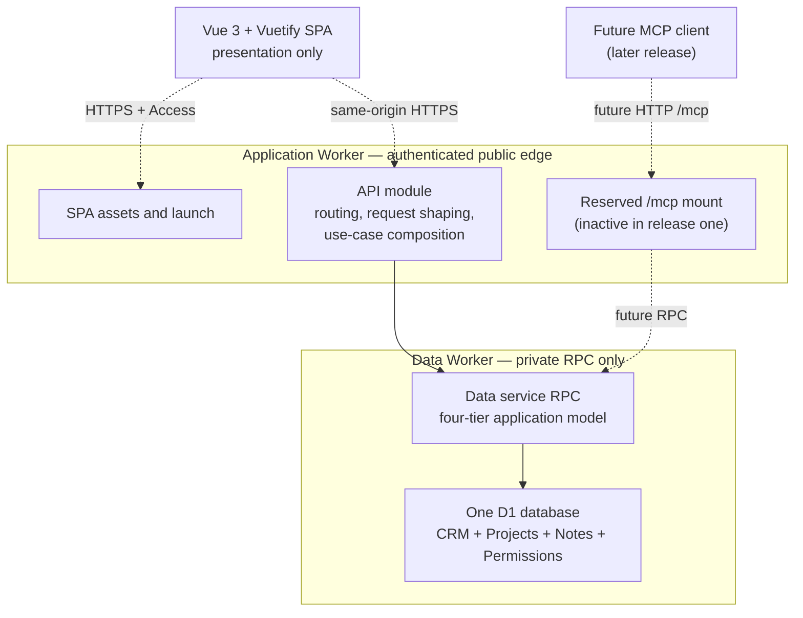

# Ignite CRM - A microservices-based CRM for small businesses

## 1. Overview

**Ignite CRM** is a small-business CRM built as a set of independent Cloudflare microservices —
Workers and Durable Objects, each owning one capability and reachable only by typed RPC — fronted by
a single API-driven Worker and a single-page application. There is no shared database that every
service reaches into directly; a service's data is reachable only through that service's own
interface, the same discipline a multi-team SaaS company would apply to its own backend.

The product combines three ideas that are each proven on their own but rarely built together as one
coherent small-business tool:

- **A static-schema CRM**, modeled on [**OnePageCRM**](https://www.onepagecrm.com/) rather than a
  dynamic-object system like HubSpot or Salesforce. Contacts, companies, deals, and activities have
  a fixed, well-understood shape. There is no custom-object builder, no dynamic schema editor, and
  no per-tenant field engine. This is a deliberate simplicity choice: a small business wants a CRM
  that already knows what a "deal" is, not a platform it has to configure into being one.
- **Linear-style delivery tracking.** (cf: [Linear](https://linear.app/)) A deal that is won does
  not just change status — it can become a **project**, and a project has **tasks** with status,
  assignment, and priority, tracked against the same customer record the deal came from. This is the
  seam between "we sold it" and "we are delivering it" that a pure sales CRM leaves to a
  spreadsheet.
- **Notion/Obsidian-style notes.** Every customer, deal, and project accumulates free-form,
  lightweight-markdown notes — meeting notes, call notes, decisions — that are searchable and linked
  back to the record they describe, rather than living in a separate notes app disconnected from the
  CRM. (see also: [Notion](https://www.notion.com/) and [Obsidian](https://obsidian.md/))

A future connected LLM interface (OpenCode, Claude, ChatGPT, or any MCP-capable client) is planned
as a first-class interface into the product, not an add-on chatbot bolted onto the UI afterward. It
is deliberately deferred from the first release; when added, it will use the same permission model
as a logged-in browser user.

> **Note**: This software will not be built as a SaaS (software-as-a-service) in the style of
> OnePageCRM, Notion, and Linear. Instead, this is a demo that a customer will deploy on the
> Cloudflare platform for their own use. Multiple customers will be supported via multiple
> installations on different domains.

### 1.1 Why microservices, and why this is worth teaching

Most Cloudflare Workers demos in this repository are a single Worker talking to its own bindings.
Ignite CRM is deliberately different: it teaches how to decompose a real business application into
several independently deployable Workers/Durable Objects that only ever talk to each other through
Workers RPC (`WorkerEntrypoint` / service bindings), never through an internal HTTP API and never by
reaching into one another's storage.

That decomposition is the main engineering lesson of this demo:

- **Each microservice owns its data exclusively.** The CRM data service owns its D1 database; the
  Projects and Notes services each own their own store; the permissions/identity service owns its
  own. No other service, and no route handler in the API Worker, ever opens a binding to a
  microservice's storage directly.
- **RPC is the only cross-service contract.** A microservice exposes a typed `WorkerEntrypoint`
  class. Callers — the API Worker, other microservices, and the MCP server — call methods on it the
  same way they would call a local function, with full type safety and no hand-rolled JSON-over-HTTP
  contract to keep in sync.
- **Authorization is re-asserted at every boundary.** The API Worker authenticates the human (or the
  MCP client acting for them) once, but every microservice RPC call still carries and re-checks the
  caller's identity and role before acting. A microservice must not trust that "the call arrived" is
  the same thing as "the call is authorized" — see §1.2 and the permissions-service responsibilities
  in [`01-specification.md`](./01-specification.md).
- **A feature can require coordinating several services in one request**, and that coordination
  lives in the API Worker's application layer, not scattered across the client. Converting a won
  deal into a project, for example, touches the CRM service (deal), the projects service (new
  project, linked to the deal and the customer), and the permissions service (who may see the new
  project) — all from one use case, in one place.

This is the opposite lesson from a demo like Architect, where the point is a narrow Durable Object
doing exactly one job. Here the point is that a handful of narrow services, each doing its own job
well, can be composed into one coherent product without ever letting the seams leak into the data
model.

### 1.2 Why RBAC is a first-class service, not a column

A small business is not a single-tenant toy: an owner, a sales rep, and a delivery lead need
different views of the same customers, deals, and projects, and that difference has to be real
authorization, not a UI affordance that a crafted request can bypass. Ignite CRM therefore treats
roles and permissions as their own microservice rather than an `is_admin` boolean on a `users`
table:

- Every actor (human or MCP-connected agent acting for a human) is assigned one or more **roles**.
- Every RPC method on every microservice accepts the caller's verified identity and asks the
  permissions service — or a cached, short-lived decision derived from it — **"may this identity
  perform this action on this resource?"** before doing anything else.
- Cloudflare Access establishes **who the caller is**. The permissions service, consulted by every
  microservice, decides **what they may do**. Neither is sufficient on its own, and this mirrors the
  defence-in-depth rule the rest of this repository already follows for Access-gated routes (see the
  root [`AGENTS.md`](../../AGENTS.md#access-control-cloudflare-access)).
- Role definitions, and the specific actions/resources each role may touch, are detailed in
  [`01-specification.md`](./01-specification.md), including the seed roles (owner, manager, sales
  rep, delivery/project contributor, read-only/reporting) a small business actually needs on day
  one.

### 1.3 What "static data model" means here, concretely

OnePageCRM's data model (see its
[public data-model documentation](https://developer.onepagecrm.com/getting-started/data-model/)) is
the reference for the sales side of Ignite CRM precisely because it is deliberately **not**
infinitely extensible:

- **Contacts** are an important hub, but not the exclusive parent of every record. A deal has one
  primary contact; calls and meetings have one or more linked contacts; and a company can gather the
  people and work associated with one organization. Notes are their own linked knowledge records,
  not contact-owned activity rows. This reflects the way a real customer meeting works: it can
  involve several people at one company, concern one particular deal, and still be useful context on
  the company itself.
- **Companies** are lightweight containers that group contacts, and they have no owner of their own.
  "Lightweight" means they carry no sales state and no custom-object machinery — it does **not**
  mean they are an empty label. A company is a real record with its own fields: a name, a business
  address, an optional stock ticker symbol, an optional
  [Companies House](https://find-and-update.company-information.service.gov.uk/) registration link
  for UK-registered companies, and a **primary contact**. That primary contact is a pointer into the
  company's own contact list, and the product must keep it honest: deleting the contact who is
  currently a company's primary contact reassigns the role to another contact at that company (or
  clears it when there is nobody left), rather than leaving the company pointing at a deleted
  record. Companies still come into being the OnePageCRM way — save a contact with a company name
  and the company record is created or reused — so a user never has to create one before they can
  file a lead.
- **Deals** have a fixed status vocabulary (`pending`, `won`, `lost`), a numeric pipeline stage, one
  primary contact, and one owner, independent of the contact's owner. On top of that fixed
  vocabulary, a deal carries a short **user-defined status line** — free text such as "Waiting for
  contract sign" or "Legal review, their side" — because `pending` alone never answers the only
  question a weekly pipeline review actually asks. A deal may also carry a **next action**: a short
  description plus a date, so the deal itself can appear in the follow-up worklist rather than
  relying on an activity logged against the contact. The fixed vocabulary stays the thing the system
  reasons about (reporting, pipeline summaries, won-deal-to-project conversion); the user-defined
  line and next action are for the humans, and are never parsed or branched on.
  - A deal's primary contact is **not** necessarily its company's primary contact. The person who
    signs the cheque for one deal, the day-to-day technical contact on another, and the person the
    company considers its main point of contact are frequently three different people. These are
    separate fields with separate meanings and neither one defaults from or overwrites the other.
- **Activities** are a small, fixed set of interaction-history types — initially calls and meetings,
  not notes. An activity has one author and can link to **multiple contacts**, an optional company,
  and an optional deal. It is not artificially forced to choose a single parent: a meeting involving
  two customer stakeholders about a renewal deal is discoverable from both people, their company,
  and the deal. The first release records the interaction; it deliberately does not yet create a
  scheduling/calendar event (§6).
- **One next action per contact** drives a prioritized worklist (OnePageCRM's "Action Stream")
  rather than an open-ended task board for sales activity. A deal's own next action (above) feeds
  the same worklist, so a rep has one follow-up queue covering both "chase this person" and "chase
  this deal" — not two competing lists. Ignite CRM's **Linear-style task board** is a different
  thing again: it exists one layer up, for **project** work, and is intentionally a separate, richer
  model (§1.4).

Ignite CRM adopts this shape rather than a dynamic/custom-object model (HubSpot, Salesforce) because
a small business benefits more from a CRM that already understands what a "deal" and a "contact" are
than from a platform it must first configure. The full field-level schema is in
[`01-specification.md`](./01-specification.md).

### 1.4 Where the CRM ends and project delivery begins

The distinguishing idea of Ignite CRM is a deliberate, visible seam: a **deal** is a sales artifact
with a fixed shape; a **project** is a delivery artifact with a Linear-style task board. The product
makes the transition between them an explicit, auditable action rather than an implicit status
change:

- A deal reaching `won` status can be **converted into a project** in one action. Conversion creates
  a project linked back to the originating deal and to the deal's customer; it does not delete or
  replace the deal, so the sales history stays intact.
- A **project** has **tasks**: title, description, status (a small workflow such as `todo`,
  `in_progress`, `in_review`, `done`), priority, assignee, and due date — the familiar Linear
  vocabulary, deliberately narrow rather than a fully configurable workflow engine.
- A project and its tasks remain visible from the customer's record, so "what are we delivering for
  this customer right now" is always one click from "who is this customer and what did we sell
  them."
- Not every project need originate from a deal — see §4 for the Should/Could-level support for
  standalone projects — but the won-deal-to-project path is the Must-have, first-class flow.

### 1.5 Notes as the connective tissue

Notes are **separate knowledge records**, not an activity subtype and not a text field owned by one
contact. Like a small, practical slice of Notion or Obsidian, a note is a timestamped, free-form,
lightweight-markdown document authored by a specific user that can be linked to **many** records:
multiple contacts, companies, deals, and projects. A meeting decision concerning two stakeholders,
their company, and a delivery project is written once, then discoverable from all four contexts.
Notes are:

- **Multi-linked, not siloed.** A note has a set of typed links rather than one mandatory parent.
  Adding or removing a link changes where it is surfaced; it does not copy the note or change its
  author. The Notes service owns these links and validates that the target records are visible to
  the author before creating them.
- **Searchable.** Full-text search across a user's visible notes is a Must-have, not a later
  enhancement — a Notion/Obsidian-flavored notes feature that cannot be searched is not actually
  useful. Search results show their linked context, so the user can tell whether a matching note was
  about a customer, deal, or project.
- **Markdown-rendered**, favoring the parts of markdown a meeting note actually needs — headings,
  lists, bold/italic, links, and simple checklists for action items — rather than attempting a full
  Obsidian-style linked-wiki graph in the first release (see §6, Won't Have).

## 2. Jobs to be done

These are the jobs a small business owner or team member is "hiring" Ignite CRM to do, independent
of any specific feature. They anchor the user stories and MoSCoW rankings in §3–§4.

| #   | Job to be done                                                                                                                                                | Primary actor               |
| --- | ------------------------------------------------------------------------------------------------------------------------------------------------------------- | --------------------------- |
| J1  | When I meet or talk to a prospect, let me capture who they are and what was said without losing the thread of our relationship.                               | Sales rep / owner           |
| J2  | When I'm deciding who to follow up with today, let me see my open deals and overdue activities in one prioritized view.                                       | Sales rep                   |
| J3  | When a deal closes, let me turn it into delivery work without re-entering who the customer is or what we agreed to.                                           | Sales rep / delivery lead   |
| J4  | When I'm delivering a project, let me track what's left, who's doing it, and what's blocked, the way an engineering team tracks issues.                       | Delivery lead / contributor |
| J5  | When I need context on a customer before a call, let me pull up every note, deal, and project tied to them in one place.                                      | Anyone customer-facing      |
| J6  | When I bring on a new team member, let me give them exactly the access their role needs — no more, no less — without hand-managing permissions per record.    | Owner / manager             |
| J7  | When I'm away from the app — in my editor, in a terminal, in a chat client — let me still ask about or update my CRM data through an assistant I already use. | Any user with an MCP client |
| J8  | When I'm running the business, let me see pipeline health and delivery health without exporting data into a spreadsheet.                                      | Owner / manager             |
| J9  | When I write something down in a meeting, let me find it again later by searching, not by remembering which customer or project it was under.                 | Anyone customer-facing      |
| J10 | When I'm deploying or operating this product, let me stand it up and tear it down cleanly, the way every other demo in this repository does.                  | Operator / demo presenter   |

## 3. User stories

> **Release-one boundary:** MCP and all external LLM access are deferred to a separate release. The
> MCP stories below describe the planned extension only; they are not first-release acceptance
> criteria.

Organized by the role primarily served. Each story is tagged with its MoSCoW priority from §4's
framework so the two sections read consistently; `[M]`/`[S]`/`[C]`/`[W]` mean
Must/Should/Could/Won't for the **first release**.

### 3.1 Sales and customer relationship (contacts, companies, deals, activities)

- `[M]` As a sales rep, I can create a contact with a name and/or company so a new lead has a home
  the moment I learn about them.
- `[M]` As a sales rep, I can log a call or meeting once and link it to every contact who attended,
  the company, and the deal it concerned, so the interaction is visible wherever a colleague would
  reasonably look for it rather than being filed under an arbitrary single person.
- `[M]` As a sales rep, I can find a call or meeting from any of its linked contacts, company, or
  deal, so a complete customer history does not depend on remembering how it was originally filed.
- `[M]` As a sales rep, I can create a deal against a contact, set its pipeline stage, and move it
  toward `won` or `lost` so my pipeline reflects reality.
- `[M]` As a sales rep, I can write a short free-text status line on a deal (e.g. "Waiting for
  contract sign") so a pipeline review can see why a deal is where it is without opening it.
- `[M]` As a sales rep, I can set a next action — a short description and a date — on a deal, so the
  deal appears in my follow-up worklist in its own right.
- `[M]` As a sales rep, the primary contact I set on a deal is independent of the company's primary
  contact, so I can sell to the person who actually decides without rewriting the company record.
- `[M]` As a sales rep, I can record a company's address, stock symbol, and Companies House link, so
  the company record is useful on its own and not just a grouping label.
- `[M]` As a sales rep, when I delete the contact who is a company's primary contact, the company's
  primary contact is reassigned (or cleared) automatically, so no company is left pointing at
  somebody who no longer exists.
- `[M]` As a sales rep, I can see a prioritized list of my open deals and overdue follow-ups so I
  know who to contact today.
- `[M]` As a sales rep, I can search contacts, companies, and deals by name so I can find a record
  in seconds during a call.
- `[S]` As a sales rep, I can tag a contact and filter by tag so I can build lightweight segments
  (e.g. "trade show leads") without a campaign tool.
- `[S]` As a manager, I can reassign a deal's or contact's owner so coverage survives a rep being
  out or leaving.
- `[C]` As a sales rep, I can mark a contact private so only I can see it, matching OnePageCRM's
  privacy model for sensitive relationships.
- `[W]` As a sales rep, I cannot yet sync a deal or contact with an external CRM or spreadsheet;
  that is deliberately out of scope for the first release (§6).

### 3.2 Delivery (projects and tasks)

- `[M]` As a delivery lead, I can convert a won deal into a project in one action, with the project
  automatically linked to the originating deal and customer.
- `[M]` As a delivery lead, I can create tasks on a project with a title, status, priority,
  assignee, and due date.
- `[M]` As a project contributor, I can see the tasks assigned to me across every project I'm on, so
  I have one worklist instead of one per project.
- `[M]` As a delivery lead, I can move a task through its status workflow (e.g. `todo` →
  `in_progress` → `in_review` → `done`) so the board reflects current reality.
- `[S]` As a delivery lead, I can create a standalone project not linked to any deal, for internal
  or non-sales-originated work.
- `[S]` As anyone customer-facing, I can see a customer's active and past projects from their
  contact record, so I know what we're delivering for them without switching screens.
- `[C]` As a delivery lead, I can define a custom task workflow per project rather than using the
  default status set.
- `[W]` As a delivery lead, I cannot yet track time or budget burn-down against a project; that is
  out of scope for the first release (§6).

### 3.3 Notes and knowledge

- `[M]` As anyone customer-facing, I can create a markdown note that is timestamped and attributed
  to me automatically, without having to choose one arbitrary parent record for it.
- `[M]` As anyone customer-facing, I can link the same note to multiple contacts, companies, deals,
  and projects so I can find it from any context it actually concerns.
- `[M]` As anyone customer-facing, I can search my visible notes by text and see each result's
  linked context, so I can find what was decided without remembering where I wrote it.
- `[S]` As anyone customer-facing, I can see a customer's full note history in reverse-chronological
  order, including notes linked through that customer's contacts, companies, deals, and projects.
- `[C]` As anyone customer-facing, I can link one note to another, or reference a contact/company/
  deal/project inline, Obsidian-style.
- `[W]` As anyone customer-facing, I cannot yet build a full backlinked knowledge graph across
  notes; that is out of scope for the first release (§6).

### 3.4 Roles, permissions, and administration

- `[M]` As an owner, I can invite a teammate and assign them a role (owner, manager, sales rep,
  delivery contributor, or read-only) so their access matches their job.
- `[M]` As any user, the actions and records I can see and change are enforced by my role on every
  request, not just hidden in the UI.
- `[M]` As an owner, I can see which identity is responsible for every create/update/delete action
  across the CRM, projects, and notes, for accountability.
- `[S]` As an owner, I can change a teammate's role, and the change takes effect on their next
  request without requiring them to re-authenticate.
- `[C]` As an owner, I can define a custom role with a hand-picked set of permissions, beyond the
  seeded roles.
- `[W]` As an owner, I cannot yet scope a role down to a subset of records (e.g. "this rep may only
  see deals they own") beyond ownership-based visibility already implied by the data model; granular
  per-record ACLs are out of scope for the first release (§6).

### 3.5 Reporting and visibility

- `[M]` As an owner, I can see a pipeline summary (deal counts and value by stage) so I understand
  sales health at a glance.
- `[S]` As an owner, I can see a delivery summary (task counts by status across active projects) so
  I understand delivery health at a glance.
- `[C]` As an owner, I can export pipeline or delivery data as CSV for use outside the application.
- `[W]` As an owner, I cannot yet build a custom report or dashboard; that is out of scope for the
  first release (§6).

### 3.6 AI-assisted / MCP access

- `[M]` As a user with an MCP-capable client (OpenCode, Claude Desktop, ChatGPT, etc.), I can
  connect it to Ignite CRM and ask it questions about my contacts, deals, and projects, scoped to
  exactly what I am allowed to see.
- `[M]` As a user, I can ask my connected assistant to create or update a record (a note, a task, a
  deal stage) on my behalf, and have that change subject to the same permission checks as if I had
  made it in the browser.
- `[S]` As a user, I can ask my connected assistant to summarize a customer's history before a call,
  drawing on their notes, deals, and project status.
- `[C]` As a user, I can ask my connected assistant to draft a follow-up note or task from a
  conversation transcript I paste in.
- `[W]` As a user, my connected assistant cannot yet take autonomous, unprompted actions on a
  schedule (e.g. "follow up with every lead that goes quiet for a week"); that is out of scope for
  the first release (§6).

### 3.7 Platform and operations

- `[M]` As an operator, I can run `pnpm deploy` to provision every microservice, the API Worker, and
  the SPA, and `pnpm teardown` to remove all of it, leaving the account clean.
- `[M]` As an operator, I can run `pnpm start` to develop against local simulations of every
  microservice without touching production data.
- `[S]` As an operator, I can see which microservice served a slow or failed request through
  structured logging and per-service observability.
- `[W]` As an operator, I cannot yet run this product multi-region or with per-microservice
  independent scaling policies beyond what Cloudflare's platform provides by default; that is out of
  scope for the first release (§6).

## 4. MoSCoW prioritization for the first release

This section is the authoritative priority list; §3's story tags are derived from it; where the two
would ever disagree, this table wins. "First release" means the smallest version of Ignite CRM that
is a genuinely useful, demonstrable small-business CRM plus delivery tracking plus notes — not a
sales-only MVP that defers delivery or notes to a later phase. MCP is a prepared future extension,
not part of first-release acceptance.

### Must have

- Contact, company, and deal records with the static OnePageCRM-derived shape described in §1.3.
- Company records carrying name, business address, optional stock symbol, optional Companies House
  link, and a primary contact that is automatically reassigned or cleared when that contact is
  deleted.
- A deal's free-text status line and optional next action (description plus date), alongside — never
  replacing — the fixed `pending`/`won`/`lost` vocabulary and numeric pipeline stage.
- A deal primary contact that is independent of its company's primary contact.
- Calls and meetings that can each link to multiple contacts and, independently, an optional company
  and deal; every linked record surfaces the same activity, rather than a copied version.
- Separate markdown notes that can each link to multiple contacts, companies, deals, and projects.
- A prioritized worklist of open deals and overdue follow-ups per user, including deals whose own
  next-action date is due or overdue.
- Converting a won deal into a linked project in one action.
- Projects with Linear-style tasks: status, priority, assignee, due date.
- A per-user cross-project task worklist.
- Markdown notes on contacts, deals, and projects, authored and timestamped automatically.
- Full-text search across notes the current user may see.
- A dedicated permissions/RBAC microservice with seeded roles (owner, manager, sales rep, delivery
  contributor, read-only) enforced on every request to every microservice.
- Cloudflare Access authentication plus application-level identity/role verification as defense in
  depth (see §1.2).
- A microservices architecture where each capability (CRM data, projects/tasks, notes, permissions,
  identity) is an independently deployable Worker/Durable Object reachable only by typed RPC.
- A future remote MCP server exposing read/write CRM capabilities under the same user identity and
  RBAC model; this is prepared for but explicitly excluded from the first release.
- An audit trail of who created/changed/deleted each record.
- A pipeline summary view (deal counts and value by stage).
- `pnpm start`, `pnpm check`, `pnpm fix`, `pnpm deploy`, and `pnpm teardown`, each doing what the
  repository-wide rules in the root [`AGENTS.md`](../../AGENTS.md#required-scripts) require.

### Should have

- Tags and tag-based filtering on contacts.
- Deal/contact ownership reassignment.
- Standalone projects not linked to any deal.
- Customer-record rollup of active/past projects.
- Role changes that take effect without forcing re-authentication.
- A delivery summary view (task counts by status across active projects).
- MCP-assisted summarization of a customer's history (notes, deals, project status) on request.
- Per-microservice structured logging/observability sufficient to tell which service served a given
  request.

### Could have

- Private contacts, visible only to their owner (OnePageCRM parity feature).
- Custom, per-project task workflows beyond the default status set.
- Lightweight note-to-note or note-to-record linking (Obsidian-style references), short of a full
  backlink graph.
- Custom, hand-assembled roles beyond the seeded set.
- CSV export of pipeline or delivery data.
- MCP-assisted drafting of a note or task from a pasted conversation transcript.

### Won't have (this release)

These are explicitly deferred, not rejected — see §6 for the reasoning and the expected future
phase.

- Customer-facing or staff scheduling/booking (calendar availability, booking links).
- Gmail/Google Calendar or Microsoft 365 integration (mail sync, calendar sync, meeting links).
- Any third-party CRM, spreadsheet, or marketing-tool integration/sync.
- Per-record, non-ownership-based access control lists (fine-grained sharing beyond role and
  ownership).
- Autonomous/scheduled AI agent actions (the MCP surface is always explicitly invoked by a user in a
  given turn).
- A full Obsidian-style backlinked knowledge graph across notes.
- Time tracking or budget burn-down on projects.
- Custom report/dashboard building beyond the two seeded summary views.
- Multi-region or independent per-microservice scaling configuration beyond Cloudflare Workers'
  platform defaults.

## 5. Microservice map (introductory sketch)

The authoritative first-release service boundaries, RPC contracts, and data ownership are specified
in [`01-specification.md`](./01-specification.md). The earlier seven-Worker design remains available
as a comparison experiment in [`microservice-experiment/`](./microservice-experiment/). At the
first-release level, the product is organized as:

| Microservice/module     | Owns                                                                                              | Reached by                   |
| ----------------------- | ------------------------------------------------------------------------------------------------- | ---------------------------- |
| **Application Worker**  | API routes, reserved future `/mcp` mount, SPA launch/static assets, and application orchestration | Browser only                 |
| **Data Worker**         | One D1 database plus CRM, Projects, Notes, and Permissions modules behind one typed RPC contract  | Application Worker only      |
| **Vue 3 + Vuetify SPA** | Presentation only                                                                                 | Application Worker over HTTP |

The Data Worker is one deployable microservice with internal four-tier modules. Keeping CRM,
Projects, Notes, and Permissions as modules rather than separate Workers preserves the domain seams
without paying for four independent deployments and four databases in the first release.

The same shape as a diagram. The solid arrow is the typed RPC boundary; dashed arrows are public
HTTP hops. Human browser authentication uses Cloudflare Access. The `/mcp` location is reserved for
a later release but has no active endpoint in release one:

Three things the diagram is meant to make obvious:

- **There are only two Workers.** The Application Worker is the public protocol/application
  boundary; the Data Worker is the private RPC/data boundary.
- **The Data Worker is still modular.** CRM, Projects, Notes, and Permissions remain separate
  four-tier modules over one D1 port, so they can be extracted later without designing the domain
  from scratch again.
- **The future MCP and browser API are intended to be separate modules over the same data
  contract.** The first release implements only the browser API; the reserved mount and shared
  contract shape prepare a later MCP release.

The SPA is the only release-one product client making public HTTP calls, and the Data Worker is
never directly browser-accessible, per this repository's standard four-tier rule (UI → API →
application/domain → infrastructure) in the root
[`AGENTS.md`](../../AGENTS.md#architecture-four-tiers).

## 6. What this release deliberately does not do, and why

Scheduling, calendar/mail integrations, and third-party sync are real, valuable capabilities for a
production CRM — and they are exactly the kind of feature that balloons scope if pulled into a first
release. They are deferred on purpose:

- **Customer-facing and staff scheduling** (booking links, availability, calendar holds) depends on
  getting the calendar/activity data model right first, and benefits from real usage of the
  deal/project/task model before locking in a scheduling UX. It is realistic future work once the
  core CRM/project/notes loop is proven.
- **Gmail/Google Calendar and Microsoft 365 integration** is an external-identity and external-API
  surface distinct from everything else in this demo — OAuth consent flows, token storage and
  refresh, webhook or polling sync, and conflict resolution with externally-edited events. Bundling
  it into the first release would make the microservices lesson (RPC-only internal composition)
  compete for attention with an entirely different lesson (third-party OAuth integration). They
  deserve to be taught separately.
- **Other third-party integrations** (marketing tools, accounting, e-signature, etc.) are open-ended
  by nature; committing to one in the first release would misrepresent the product as more
  integration-focused than it is meant to be.

When this work is picked up, it should arrive as an additional microservice (a scheduling service,
and a separate external-calendar-sync service) composed the same way every other service in this
product is composed — through typed RPC, behind the permissions service's authorization checks —
rather than as a special-cased feature bolted onto the API Worker.

## 7. Deliverables

- [`01-specification.md`](./01-specification.md) — the system engineering specification: overall
  architecture, project organization, shared RPC contracts, cross-service consistency, security,
  infrastructure, observability, and testing.
- Independent deployable-unit specifications:
  - [`01a-permissions-spec.md`](./01a-permissions-spec.md)
  - [`01b-crmservice-spec.md`](./01b-crmservice-spec.md)
  - [`01c-projectservice-spec.md`](./01c-projectservice-spec.md)
  - [`01d-notesservice-spec.md`](./01d-notesservice-spec.md)
  - [`01e-api-spec.md`](./01e-api-spec.md)
  - [`01f-mcp-spec.md`](./01f-mcp-spec.md)
  - [`01g-spa-spec.md`](./01g-spa-spec.md)
  - [`01h-oauth-spec.md`](./01h-oauth-spec.md)
- [`02-implementation.md`](./02-implementation.md) — the phased implementation plan, with each
  phase's deliverables, tests, and exit criteria.
