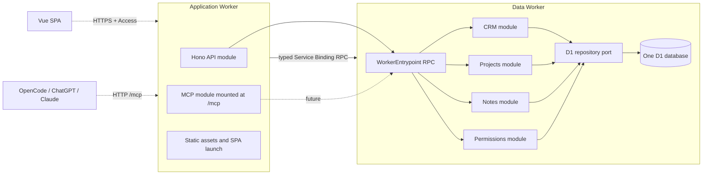

# Ignite CRM — First-release two-service engineering specification

## 1. Authority and design intent

This is the authoritative engineering specification for the first release described in
[`00-introduction.md`](./00-introduction.md). The previous seven-Worker design is retained as a
comparison exercise in [`microservice-experiment/`](./microservice-experiment/); it is not part of
the first-release implementation.

The first release deliberately demonstrates **two microservices**, not seven:

1. **Application Worker** — public HTTP API, reserved `/mcp` route, SPA launch/static assets,
   authentication boundary, and application orchestration.
2. **Data Worker** — a private RPC-only Worker containing the CRM, Projects, Notes, and Permissions
   modules. It owns one D1 database and exposes one grouped typed service contract.

The Data Worker is a modular monolith inside a microservice boundary. Its modules remain
independently structured and tested, but they share one D1 port and transaction boundary. This is
intentional: it teaches how to decompose a domain behind RPC while keeping a small
free-tier-friendly deployment.

Normative terms **MUST**, **SHOULD**, and **MAY** have their RFC 2119 meanings. Open questions are
explicit review points, not hidden implementation choices.

## 2. Fixed decisions

1. Use `cf-terraform-demos/ignite-crm`, pnpm, TypeScript strict mode, Vue 3 Composition API,
   Vuetify, Vite, Hono, Cloudflare Workers, Workers RPC, D1, Terraform, `cf`, Oxfmt, Oxlint, and
   Vitest. Wrangler is forbidden by repository policy.
2. Deploy exactly two Workers: `ignite-crm-application` and `ignite-crm-data`. The
   `ignite-crm-application` worker will be accessed through `ignite-crm.cfapps.uk` (using the
   current `.env` file showing `cfapps.uk` as the default DNS zone to use).
3. The Application Worker serves the SPA and API and reserves `/mcp` for a future MCP module. MCP is
   not implemented in release one. Its future module boundary, shared Data Worker contract, and
   route ownership are documented without adding MCP runtime dependencies or an active endpoint.
4. The Data Worker has no public domain and no useful public `fetch()` route. Its only application
   entrypoint is one grouped typed `WorkerEntrypoint` RPC object exposed through the Application
   Worker's `DATA_SERVICE` binding.
5. The Data Worker owns one D1 database. CRM, Projects, Notes, Permissions, and audit tables are
   separate table families in that database. No Application Worker code receives a D1 binding.
6. The Data Worker uses the four-tier structure inside one process:
   `RPC entrypoint → application/domain modules → repository ports → one D1 adapter`.
7. Permissions remains a module and an explicit port. Every use case asks it to authorize; this is
   not a UI-only capability check. Because it shares D1, permission and business writes may be in
   one transaction when a use case requires that guarantee.
8. No Durable Object is required in release one. The RPC service is stateless at the Worker level;
   D1 is the durable source of truth. Scheduling, live collaboration, and asynchronous
   reconciliation are deferred.
9. Cloudflare Access authenticates browser users. MCP is deferred entirely from release one,
   including MCP transport authentication and OAuth. The Application Worker reserves `/mcp` without
   registering a handler. A separate OAuth authorization Worker is deliberately not part of this
   release; OAuth-provider details remain in the experiment directory for a later extraction.
10. IDs are lowercase UUID strings from `crypto.randomUUID()`. Times are UTC ISO strings. Date-only
    values use `YYYY-MM-DD`. Money uses integer minor units and one installation currency.
11. Mutations use idempotency keys and optimistic `version` checks. Deletes are soft deletes unless
    a join/audit row is explicitly removable.
12. All public JSON errors use RFC 9457 `application/problem+json`. All internal errors crossing RPC
    are small serializable error values; callers inspect `name` and `code`, never `instanceof`.
13. Compatibility date is pinned to `2026-10-07` with `nodejs_compat`, enabling enhanced RPC error
    serialization. All Workers use the same date/flags.

## 3. Architecture



The important teaching boundary is visible: the browser API is active in release one, while MCP is
reserved as a separate future application module. All business state crosses one private RPC
boundary into a data service. Inside that data service, the modules are separate enough to extract
later.

### 3.1 Ownership

| Unit               | Owns                                                                                                   | Does not own                                                       |
| ------------------ | ------------------------------------------------------------------------------------------------------ | ------------------------------------------------------------------ |
| Application Worker | HTTP routing, Access middleware, request shaping, future MCP boundary, SPA assets, composite use cases | D1, business tables, authoritative roles, domain row persistence   |
| Data Worker        | One D1 database, CRM/Projects/Notes/Permissions modules, all business/audit state                      | Public HTTP API, SPA, future MCP protocol, external OAuth provider |
| CRM module         | Companies, contacts, deals, calls, meetings, follow-ups, pipeline reports                              | Projects, Markdown notes, role definitions                         |
| Projects module    | Projects, tasks, conversion state, delivery reports                                                    | Deal authority, note bodies, roles                                 |
| Notes module       | Markdown notes, typed multi-links, FTS5 index                                                          | Target records, HTML rendering, role definitions                   |
| Permissions module | Users, roles, role assignments, permission evaluation                                                  | JWT validation, business records                                   |

## 4. Repository organization

```text
cf-terraform-demos/ignite-crm/
├── cloudflare.config.ts                 # Application Worker definition
├── data/cloudflare.config.ts            # Data Worker definition
├── package.json
├── vite.config.ts                       # SPA + Application Worker build
├── tsconfig.json
├── oxlint.config.ts
├── vitest.config.ts
├── vitest.integration.config.ts
├── infra/
│   ├── providers.tf
│   ├── access.tf
│   ├── application.tf
│   ├── data.tf
│   ├── outputs.tf
│   └── local-outputs.json
├── migrations/
│   └── data/                            # one D1 migration stream
├── src/
│   ├── configuration.ts                 # installation currency/region/display settings
│   ├── shared/                          # runtime-neutral contracts and protocol schemas
│   │   ├── common/{ids,dates,paging,errors}.ts
│   │   ├── data-service/                # RPC values, ports, and service error codes
│   │   ├── api/                         # SPA ↔ API route schemas and DTOs
│   │   │   ├── session.ts
│   │   │   ├── crm.ts
│   │   │   ├── projects.ts
│   │   │   ├── notes.ts
│   │   │   ├── users.ts
│   │   │   └── problems.ts
│   │   ├── validation/                  # reusable scalar and cross-field schemas
│   │   └── mcp/                         # reserved schemas for later MCP release; inactive now
│   ├── application-worker/
│   │   ├── api/{middleware,routes,composition,index.ts}
│   │   ├── mcp/                         # reserved future module; no release-one implementation
│   │   └── index.ts                     # public Worker fetch entrypoint
│   ├── data-worker/
│   │   ├── entrypoint.ts                # private WorkerEntrypoint export
│   │   ├── application/{crm,projects,notes,permissions}
│   │   ├── domain/{crm,projects,notes,permissions}
│   │   ├── infrastructure/{d1,repositories}
│   │   └── index.ts                     # Data Worker module entrypoint
│   └── client/
│       ├── components/
│       ├── composables/
│       ├── router/
│       ├── services/
│       ├── views/
│       ├── App.vue
│       └── main.ts
└── tests/
    ├── fakes/
    ├── fixtures/
    ├── unit/{crm,projects,notes,permissions,api,mcp,client}/
    ├── contract/{data-service,fakes}.test.ts
    ├── integration/{application-worker,data-worker,system}/
    └── e2e/
```

Rules:

- `src/shared` is a runtime-neutral library, not a dumping ground. It contains serializable value
  types, stable enums, scalar helpers, shared RFC 9457 shapes, Data Worker RPC contracts, and
  SPA/API wire schemas/DTOs. Runtime schemas use **Valibot**, with inferred TypeScript types; do not
  create parallel hand-written request/response interfaces. Valibot's function-level tree shaking
  keeps each browser route and Worker entrypoint from carrying validators it does not use. It
  implements Standard Schema, so its schemas are accepted directly by MCP SDK v2 tool definitions;
  do not add Zod solely for MCP. `src/shared` imports no Hono, Vue, D1, Worker binding, or Worker
  implementation module.
- `src/shared/data-service` is private to server code: the Application and Data Workers import it;
  the SPA does not. It defines the typed RPC boundary but exposes no D1 rows or repository
  interfaces.
- `src/shared/api` is the browser wire contract. It exports a runtime validation schema and its
  inferred TypeScript type for every HTTP request body, query/filter shape, successful API DTO, and
  RFC 9457 problem shape. The Application Worker validates with these schemas at the edge; the SPA
  validates untrusted responses before putting them in UI state.
- `src/shared/validation` holds reusable field and cross-field rules such as UUID, cursor,
  date-only, idempotency-key, pagination, expected version, Markdown size, and safe URL validation.
  Domain modules may reuse a rule but must still express business invariants in
  `src/data-worker/domain`.
- The shared schema library is an internal source library, not an externally versioned public API.
  The browser bundle includes only imports reachable from `src/shared/api`, `common`, and
  `validation`; it must never pull RPC or Worker-only contracts into the client bundle.
- `src/data-worker/domain` is pure business logic. It has no D1, RPC, Hono, or platform imports.
- `src/data-worker/application` owns use cases and authorization decisions. It depends on repository
  and permission ports, never concrete adapters.
- `src/data-worker/infrastructure` implements the D1 port and repository interfaces. SQL stays here
  or in the single migration stream.
- `src/data-worker/entrypoint.ts` constructs one composition root per invocation and exposes only
  the typed RPC contract. It never returns D1 rows or repository objects.
- `src/application-worker/api` and `src/application-worker/mcp` share framework-neutral coordinators
  where useful, but their transport shaping, input schemas, protocol errors, and tests remain
  separate.
- `src/client` is the Vue SPA source root. Its typed HTTP client imports the corresponding
  `src/shared/api` request/response schemas; it does not import `src/shared/data-service`, either
  Worker module, server implementation contracts, or Cloudflare bindings. Vite bundles it as
  Application Worker static assets.
- `pnpm check` runs generated type freshness for both Worker configs. Generated `.cloudflare/` files
  are ignored and explicitly included in TypeScript.

## 5. Cross-cutting contracts

### 5.1 Actor context

```ts
interface ActorContext {
  readonly email: string;
  readonly userId: string;
  readonly requestId: string;
  readonly channel: 'api'; // 'mcp' is reserved for the later release
}
```

The Application Worker obtains the verified Access identity and resolves `userId` through the Data
Worker's Permissions module. Business input never contains actor identity. The Data Worker treats
service bindings as private transport, not authorization: every RPC method checks the actor.

### 5.2 RPC contract

The Data Worker exports one contract. Its methods are grouped by module but share one service
binding:

```ts
export abstract class DataServiceContract {
  abstract health(): Promise<Health>;
  abstract resolveActor(email: string, requestId: string): Promise<ResolvedActor>;
  abstract resolveUser(userId: string): Promise<ResolvedUser>;
  abstract authorize(request: AuthorizationRequest): Promise<AuthorizationDecision>;

  abstract crm: CrmPort;
  abstract projects: ProjectsPort;
  abstract notes: NotesPort;
  abstract permissions: PermissionsPort;
}
```

The implementation may expose named `WorkerEntrypoint` exports instead of a nested RPC object if
that produces better generated types; the public contract remains one binding and one data-service
API. All methods accept/return structured-cloneable values, are bounded, and are always awaited by
callers. RPC serialized results stay far below the 32 MiB limit.

A service error has `name: 'ServiceError'`, a stable `code`, safe `message`, `retryable`, and
`requestId`. Compatibility and generated types are checked for both provider and consumer.

### 5.3 Idempotency and versioning

Every mutation stores
`(actor_id, operation, idempotency_key, request_hash, result_json, created_at)` inside the shared D1
database. Lookup occurs before version validation: same key and same canonical input returns the
original result, even after a lost response makes the caller's version stale; same key with
different input is `CONFLICT`.

Mutable records have integer `version`, starting at 1. A new input must provide `expectedVersion`.
Compare-and-swap, domain state, audit event, and idempotency result are one transaction. Retention
is 24 hours unless changed after review.

### 5.4 Authorization

Seed permissions remain the ones defined in the introduction's RBAC model. The Permissions module
answers:

```ts
authorize({ userId, permission, resource }): AuthorizationDecision
```

The owning module performs the authoritative check. Application capability hints may hide controls,
but never grant access. Permission outage fails closed as a retryable dependency error. Because all
modules use one D1 adapter, a critical business mutation may authorize and write within one
transaction when that use case requires it.

## 6. Data model and D1 port

The single `DATA_DB` contains these table families:

- `users`, `roles`, `role_permissions`, `user_roles`;
- `companies`, `contacts`, `tags`, `contact_tags`, `pipelines`, `pipeline_stages`, `deals`;
- `activities`, `activity_contacts`, `follow_ups`;
- `projects`, `tasks`, `conversion_attempts`;
- `notes`, `note_links`, `notes_fts` and FTS triggers;
- shared `audit_events` and `idempotency_records`.

All tables are STRICT, all timestamps are UTC text, and local foreign keys are used where the
relationship is inside the data service. Polymorphic note links use a checked target-type enum and
application validation. Search uses D1-supported FTS5.

The D1 port is deliberately narrow:

```ts
interface D1Port {
  read<T>(statement: SqlStatement): Promise<readonly T[]>;
  readOne<T>(statement: SqlStatement): Promise<T | null>;
  transaction<T>(work: (tx: D1TransactionPort) => Promise<T>): Promise<T>;
}
```

Repositories receive `D1Port`, not `D1Database`. Unit tests use an in-memory fake port; Workers
runtime adapter tests use the real D1 binding and the committed `migrations/data` stream. No module
constructs SQL outside infrastructure.

### 6.1 Domain rules retained from the introduction

- Companies carry name, business address, optional stock symbol, optional Companies House link, and
  a primary contact. Deleting that contact chooses the oldest remaining active company contact or
  clears the field transactionally.
- A deal has fixed `pending|won|lost` status, stage, owner, free-text status line, optional next
  action text/date, and a primary contact independent of the company's primary contact.
- Activities are calls/meetings linked to multiple contacts and optional company/deal. They are not
  notes or scheduling events.
- Notes are separate Markdown documents with many typed links to contacts, companies, deals, and
  projects. A note requires at least one link. FTS5 search is bounded and safe.
- Projects/tasks use fixed Linear-style statuses and priorities. A won deal can become one project.

## 7. Cross-module workflows

### 7.1 Deal-to-project conversion

Because all state is in one D1 database, conversion is one Data Worker application transaction:

1. authorize `deal.convert`;
2. lock/verify the deal is `won` and has no project;
3. create project and conversion record;
4. set deal `project_id`;
5. write audit and idempotency records;
6. commit and return the project as fully linked.

There is no `pending` source-link state, retry endpoint, distributed saga, or cross-Worker partial
success in this architecture. A transaction failure rolls back the complete conversion. This is the
main practical contrast with `microservice-experiment/`.

### 7.2 Multi-linked note creation

The Data Worker validates all target IDs against the same D1 snapshot, checks actor visibility,
writes one note plus all links and audit/idempotency rows in one transaction. The Application Worker
only coordinates transport input and response hydration; it never creates a validated-reference
capability.

### 7.3 Audit

One `audit_events` table supports `listAudit` in the Data Worker. The Application Worker exposes one
owner/manager-only audit route without merging per-service cursors. Events identify module, entity,
action, actor, request, and safe before/after metadata. Note bodies are represented by a digest, not
copied into audit rows.

## 8. Application Worker API and future MCP boundary

### 8.1 HTTP/API module

Use `@demos/worker-common` for Access middleware, identity, JSON limits, RFC 9457 errors,
same-origin checks, and `/api/me`. `/api/me` returns the shared router's primitive identity shape. A
separate `GET /api/v1/session` returns resolved role summaries/capability hints.

Base `/api/v1` routes cover users/roles, contacts, companies, deals, activities, follow-ups, action
stream, projects/tasks, notes/search/links, reports, customer overview, and audit. Every mutation
uses `Idempotency-Key`; update/delete uses `If-Match`. Every route parses the applicable
`src/shared/api` request schema before calling a coordinator, then serializes a DTO matching the
shared success schema. The API calls only the Data Worker binding and returns composite view models,
never raw D1 rows.

Composite reads use bounded parallel RPC calls where useful. A core CRM failure fails the request;
optional notes/project sections may return an explicit partial warning. Authorization failures are
never downgraded to partial data.

### 8.2 Reserved `/mcp` boundary

The Application Worker reserves `/mcp` for a separate future module, but release one does not
register an MCP handler, import MCP SDK dependencies, expose MCP tool schemas, or run MCP protocol
tests. This keeps the route and Application/Data Worker boundary ready without putting MCP code or
open authentication questions into the first release.

The deferred release will add its own handler, schemas under `src/shared/mcp`, tool catalogue,
limits, logging, tests, and authentication. It will call the same grouped Data Worker RPC object;
this specification intentionally does not decide its transport authentication.

## 9. Installation configuration

`src/configuration.ts` is the single non-secret installation configuration object. It is imported by
server-side application modules and by browser-safe display configuration only through an explicit
serialized DTO. It contains:

```ts
interface InstallationConfiguration {
  readonly region: string;
  readonly locale: string;
  readonly timezone: string;
  readonly currencyCode: string;
  readonly currencySymbol: string;
  readonly dateFormat: string;
  readonly numberFormat: string;
  readonly weekStartsOn: 0 | 1;
}
```

The first-release default is a reviewed UK-oriented configuration (`region: 'GB'`,
`locale: 'en-GB'`, `timezone: 'Europe/London'`, `currencyCode: 'GBP'`, `currencySymbol: '£'`) and is
replaceable at installation/deployment time. Configuration is validated at startup with Valibot.
Secrets, Access audiences, account IDs, and tokens are bindings or environment outputs, never
committed to this file. The API exposes only the safe display subset needed by the SPA; the client
does not import server configuration directly.

## 10. SPA

The Application Worker serves Vue 3 static assets and launches the SPA. The browser calls only the
API module over same-origin HTTP. The SPA uses Composition API, Vue Router, a typed API client, and
a module-scoped identity cache. It implements the routes and accessibility requirements in the
original SPA experiment spec, but all data comes from the Application Worker API.

No business data is stored in localStorage. Markdown is rendered with HTML disabled and safe URL
protocols. Forms preserve drafts on 409 conflicts; all drag/drop interactions have keyboard
controls. WCAG 2.2 AA is required.

### 10.1 Component library

**Vuetify is the SPA component library for this release.** Every piece of user interface is built
from Vuetify components and its theme/layout system unless Vuetify has no suitable component.

- Register Vuetify explicitly in `src/client/main.ts` with named component imports and only the
  directives the SPA actually uses, matching the existing `cf-terraform-demos` convention. Do not
  register the whole component set implicitly; the SPA ships in the Application Worker's asset
  bundle and unused components are avoidable weight.
- Use one Vuetify theme as the single source of colour, spacing, elevation, typography, and density.
  Application CSS configures that theme; it does not restyle Vuetify internals with overrides that
  fight the library's own tokens.
- Use Vuetify's own primitives for layout, navigation, data tables, lists, forms, validation
  display, dialogs, menus, chips, and feedback/progress surfaces rather than hand-rolled
  equivalents. A Vuetify form control is the default choice for every input in the product.
- Vuetify components must not leak outside `src/client`. `src/shared`, the Application Worker, and
  the Data Worker import no Vuetify module.

Where Vuetify genuinely has no suitable component — the Linear-style task board, the multi-record
note link chooser, the action-stream row, and the Markdown composer/renderer are the expected cases
— build a **general-purpose local component in Vuetify's style**, not a one-off view fragment:

- Place it in `src/client/components` with a documented, reusable props/emits/slots API, in the same
  shape a Vuetify component would present. It takes data and emits intent; it does not call the API
  client or own application state.
- Compose it from Vuetify primitives wherever possible, and consume Vuetify theme tokens, density,
  spacing, elevation, and typography so it is visually indistinguishable from a Vuetify component in
  both light and dark themes.
- Match Vuetify's accessibility behaviour: semantic roles, labelling, keyboard interaction, visible
  focus, disabled/loading/error states, and WCAG 2.2 AA target sizes.
- Give it its own DOM-level unit tests covering its public props/emits contract, keyboard operation,
  and error/empty states, exactly as a library component would have.
- Record in the README why Vuetify could not supply it. A custom component is a reviewed exception,
  not a convenience; a near-miss Vuetify component with a small adaptation is preferred over a new
  bespoke one.

Client tests mount components with a real `createVuetify()` instance and inline Vuetify in the
Vitest client project, so theme-dependent and density-dependent behaviour is exercised rather than
stubbed away.

## 11. Security and observability

- Production API paths are Access-gated and validate the exact audience in the Worker.
- Development uses signed development tokens through the shared Access middleware; production cannot
  enable that bypass.
- Internal Data Worker has no public domain and no user-controlled service binding selection.
- Identity headers are scrubbed before trusted identity is stored in context.
- SQL is parameter-bound and sort/filter fields are allowlisted.
- Logs contain service/module, operation, request ID, actor ID when known, duration, outcome, and
  dependency result; never note bodies, JWTs, tokens, addresses, or free-text status lines.
- Both Workers enable structured logs/traces with the pinned compatibility date.
- Metrics distinguish Application HTTP operations from Data Worker module/RPC operations. MCP
  metrics are added with the deferred MCP release.

## 12. Infrastructure and lifecycle

Terraform owns two Worker registrations, one D1 database, Access applications/policies, and the
`ignite-crm.cfapps.uk` custom hostname/DNS resource. It does not provision MCP authentication in
release one. `cf`/Vite owns code, assets, service binding, and D1 binding attachment. Worker
registration explicitly depends on its binding resources; API custom domain has a stable bootstrap
version/deployment with `ignore_changes = all`.

`infra/outputs.tf` exposes scalar `data_d1_database_id`, `data_d1_database_name`,
`application_worker_name`, `data_worker_name`, `application_hostname` (fixed to
`ignite-crm.cfapps.uk`), and Access audience values. `infra/local-outputs.json` contains matching
placeholders. The root migration helper runs one `migrate:local` and one `migrate:remote` command
for `migrations/data`.

Required scripts use `run-s` and are individually runnable:

- `start`: migrate local D1, then `cf dev --persist-to .cloudflare/state`;
- `check`: generated types for both configs, strict TypeScript, Oxfmt check, type-aware Oxlint,
  Terraform validate/fmt check, and dry build;
- `fix`: generated types, Oxfmt write, safe Oxlint fixes, Terraform fmt;
- `test`: unit, DOM, contract, Workers-runtime integration, and offline E2E;
- `check:bundles`: build production assets and record SPA, Application Worker, and Data Worker
  sizes; this is observational in release one and does not enforce free-tier account budgets;
- `deploy`: Terraform apply → write outputs → remote migration → production build → deploy Data
  Worker then Application Worker with `cf deploy --prebuilt --worker`;
- `teardown`: delete Application Worker first, then Data Worker, then Terraform destroy.

No R2, Queues, Durable Objects, separate OAuth Worker, active MCP handler, or third-party
integration is provisioned in release one.

## 13. Testing strategy

### 12.1 Pure module tests

Test CRM, Projects, Notes, and Permissions domains independently with no Workers runtime. Cover all
validation, role matrices, company primary reassignment, multi-contact activities, deal next action,
project/task transitions, note links/FTS query escaping, audit, and D1-port transaction behavior.

### 12.2 Data Worker tests

Run the same `dataServiceContractTests` against the real `DataEntrypoint` and an in-memory
`FakeDataService`. Use the real Workers runtime and `cloudflare:test` for D1 adapter/migration
tests. Inject fake D1 ports for application tests and assert rollback on every multi-table failure.

### 12.3 Shared-contract and Application Worker tests

For every `src/shared/api` route schema, test all three consumers: the Application Worker accepts
the same valid/invalid requests, its output satisfies the response schema, and the SPA API client
rejects a malformed response before it reaches UI state. Contract tests use fixture
requests/responses rather than mock implementation internals. This makes wire drift build-failing.

Run the Application API module against a typed fake Data Worker that passes the contract suite. Test
Access JWT success/wrong audience/expiry, smuggled headers, API errors, actor propagation, timeouts,
and partial composite reads. MCP protocol tests and MCP fakes are deferred with the MCP release. The
Application Worker has no D1 fixture.

### 12.4 System integration

Run both Workers locally under the Workers Vitest integration with the Data Worker as a service
binding. Apply the single migration stream before tests. Cover browser auth, owner invite, contact →
deal → win → atomic project conversion, multi-linked activity, multi-linked searchable note, denied
role action, and Data Worker outage. MCP integration is deferred. Integration timeout is finite at
30 seconds.

### 12.5 E2E and contract acceptance

Playwright runs offline against `pnpm start` in desktop/mobile viewports and keyboard-only critical
flows. Every fake and real Data Worker implementation passes the same contract suite. No test
depends on live Cloudflare infrastructure.

## 14. Performance and failure behavior

- Target p95 excluding cold starts: API reads <500 ms, writes <750 ms, composites <1,500 ms.
- One RPC call may serve a bounded composite use case; no N+1 loops.
- Data Worker transactions are short and contain no network calls.
- Valibot is the sole runtime validator in browser and Worker production bundles; a test prevents
  `zod` from being added as a transitive application-validation dependency.
- Data Worker failure returns retryable 503/problem details from API and safe MCP errors.
- There are no distributed partial states in release one. D1 transaction failure is all-or-nothing.
- Notes search is 2–200 characters, max 50 results; note body is 64 KiB; RPC pages max 100.

## 15. Definition of done

- `pnpm check` and `pnpm test` pass offline.
- Two Workers deploy and teardown cleanly on a free-tier-compatible account.
- API and MCP exercise the same Data Worker RPC contracts.
- Every data module is independently unit-testable and the Data Worker is independently deployable.
- The deal conversion and multi-linked note workflows are atomic inside D1.
- README documents topology, local setup, deploy/teardown, and why this is a modular monolith inside
  one RPC microservice.

## 16. Open questions

There are no open questions blocking the first release. MCP transport/authentication and all related
questions are deferred to the separate MCP release.

The first-release decisions are:

- The Data Worker exposes **one grouped RPC object**.
- `src/configuration.ts` is the installation configuration object. It contains currency/region
  settings, including currency code, currency symbol, date format, locale, timezone, number format,
  week-start convention, and shared display settings used by API and SPA. It is validated at startup
  and has one committed safe default for local development; secrets remain bindings/environment
  values, not configuration source.
- D1 read replication is disabled for release one.
- One custom hostname serves the SPA and API: `ignite-crm.cfapps.uk`. `/mcp` is reserved on that
  same hostname for the later MCP release.
- Bundle-size measurements are useful observations, but free-tier account limits are not automated
  budget assertions.
