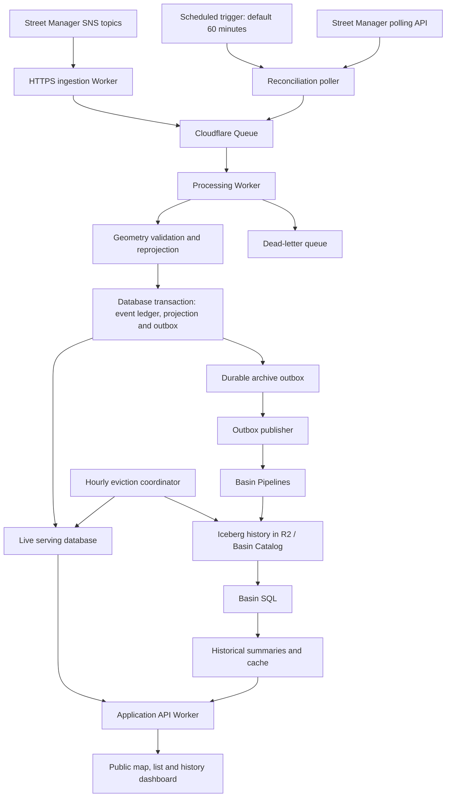
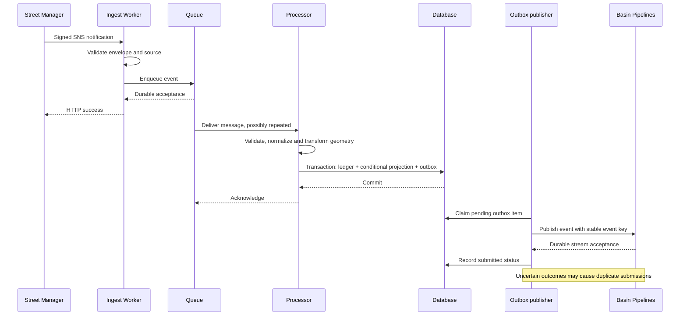
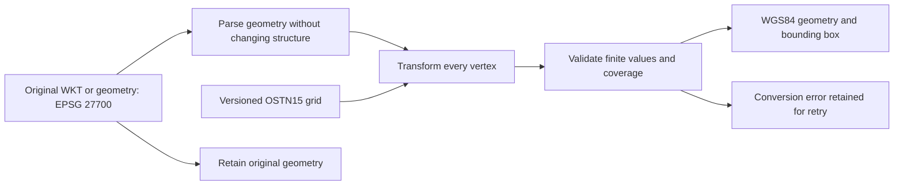
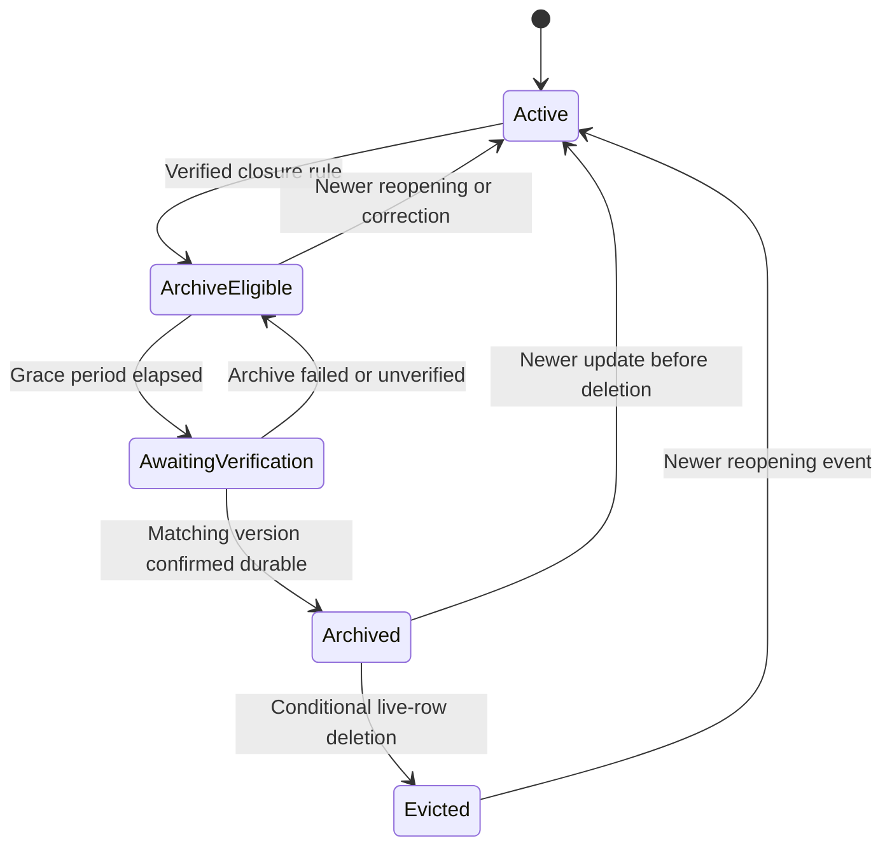

# Open Roadworks Platform — Project Specification

Status: Draft for technical and customer review  
Scope: Public live and historical roadworks dashboard, with future contractor and authority collaboration  
Currency: USD; pricing is indicative and must be revalidated before launch

## 1. Purpose and outcomes

Build an accessible, approachable platform for discovering current and historical roadworks. Preserve source events indefinitely, subject to licensing, privacy and legal requirements, while keeping the live serving database compact.

Primary audiences:

- Public: locate works, understand disruption and inspect historical activity.
- Contractors: view current works and their history.
- Local authorities: understand works and coordination context across their area.

The [Street Manager API](https://department-for-transport-streetmanager.github.io/street-manager-docs/api-documentation/) is the initial source, using V7 API and both notifications and polling for catch up events. Complete UK coverage is a product goal, not an established property of this feed. Validate England, Scotland, Wales, Northern Ireland and activity-type coverage; integrate additional sources where necessary.

Success means timely live data, traceable history, visible coverage and freshness, recoverable processing, accessible map/list views and predictable operating costs.

Focus is on replicating a web application like [Causeway one.network](https://one.network/) for live events.  This demonstration provides demonstration capabilities for data ingest and processing best practices along with Basin capabilities.  Note that "public capabilities" will still be gated behind a Cloudflare Access login (but anyone can log in) to prevent abuse and fraud.

## 2. Scope and phases

### MVP

- Street Manager SNS ingestion and scheduled reconciliation.
- Initial snapshot/backfill strategy with an explicit historical coverage boundary.
- EPSG:27700 geometry conversion to WGS84 for web-map display.
- Append-only event archive and current-state projection.
- Public map and equivalent accessible list; filters by area, date, authority, promoter and status.
- Record detail with event timeline and source attribution.
- Historical search and cached analytical summaries.
- Monitoring, dead-letter handling, replay and safe closed-record eviction.

### Later phases

- Additional regional data sources and cross-source identity resolution.
- Authenticated contractor/authority workspaces, annotations and coordination workflows.
- Public exports, alerts and documented external APIs, subject to reuse terms.

### Out of scope for MVP

- Writing changes back to Street Manager.
- Replacing statutory permit submission or approval workflows.
- Publishing private contractor/authority data.
- Survey-grade positioning guarantees or an unconditional claim of complete UK coverage.

## 3. Architecture

Workers, Queues, R2 and Basin services are billed independently of the Pro/Business website plan. Database selection is provisional: D1 may suit a bounded MVP; geographic query requirements, concurrency and limits must be benchmarked. PostgreSQL/PostGIS is an alternative with a separate hosting budget, potentially on PlanetScale or Supabase.

Basin Catalog manages Iceberg metadata. Iceberg is a table format, not a transformation engine. Basin SQL provides historical analytics; it is not the default request path for every public map interaction. Logpush is for operational logs, not the authoritative business archive.

## 4. Source integration

### 4.1 Registration and security

Register an HTTPS endpoint with Street Manager and subscribe to the required permit, activity and Section 58 topics. Handle SNS subscription confirmation and notifications separately.

Requirements:

- Verify the SNS signature and allowlisted environment-specific topic ARN before accepting content or confirming subscriptions.
- Validate certificate and confirmation URLs against expected AWS HTTPS hosts and paths; prevent SSRF and unsafe redirects.
- Handle the SNS envelope and the JSON encoded within its Message field. Do not rely solely on an application/json content type.
- Apply payload-size limits and schema checks; tolerate unknown fields and preserve the original payload.
- Acknowledge notifications only after successful durable queue insertion. Return a retryable failure when enqueueing fails.
- Keep upstream credentials in managed secrets; never expose them to browsers or logs.

Exact SNS delivery/retry behaviour and subscription settings must be verified during onboarding. Do not treat notification delivery as guaranteed.

### 4.2 Polling and reconciliation

Default polling interval: 60 minutes, configurable subject to upstream restrictions. This implies up to roughly one polling interval of recovery delay for a missed notification, plus processing time.

Persist a checkpoint per source stream/filter. Poll from the last successful checkpoint using an overlap window, enumerate all pages and advance the checkpoint only after the complete range is durably enqueued. Serialize overlapping poll runs or use a lease. Honour upstream rate limits and retry with bounded exponential backoff and jitter.

Before implementation, verify polling availability for Open Data credentials, request fields, pagination, time-window inclusivity, ordering, maximum lookback, rate limits and payload completeness. The V7 documentation references /works/updates, but its exact contract was not verified during initial design. V7 is labelled under development and V6 stable in the reviewed documentation; select a supported version with the provider.

### 4.3 Bootstrap and backfill

Establish the subscription and durable capture before importing a baseline. Reconcile baseline records against events using verified source ordering. Evaluate archived notifications and other approved exports for historical import; confirm date ranges, completeness and licences.

Display historical coverage start dates and source gaps. An archive of captured notifications does not prove every upstream state transition was captured; polling may recover only the latest snapshot depending on its contract.

## 5. Event processing and delivery semantics

Cloudflare Queues uses at-least-once delivery. Duplicates can also arise from webhook/polling overlap. No end-to-end exactly-once claim is made.

Event identity:

- Prefer a verified upstream event identity namespaced by source and environment.
- SNS MessageId may identify delivery but must not be assumed to match polling identity.
- Use a documented deterministic fallback only when needed; preserve identity provenance.

Record identity:

- Use source + environment + object type + object reference.
- Model work and permit references separately; one work may have multiple permits.

Ordering:

- Do not use arrival order as record order.
- Verify whether event_reference or another field provides ordering; do not assume version means record revision.
- Use a confirmed source ordering rule, with explicit handling of equal timestamps and conflicts.
- Archive legitimate older events even when they do not update the live projection.
- Accept full-record replacement only where payload completeness is confirmed; otherwise merge or fetch an authoritative snapshot using an approved API.

The event ledger, projection update and archive outbox must commit atomically in the selected database. Queue acknowledgement follows commit. Publisher retries must use the same event key. Basin delivery guarantees do not remove application-level duplicate submissions; historical queries and materializations must deduplicate by event key.

Retain outbox payloads until archival verification, not merely stream acceptance. Drain failures through observable retries and a dead-letter workflow. Ledger/outbox retention must be bounded only after durable history is confirmed; otherwise the supposedly small live database will grow indefinitely.

## 6. Coordinate conversion

Source CRS: EPSG:27700, OSGB36 / British National Grid, easting/northing in metres. Display CRS: WGS84 geographic coordinates associated with EPSG:4326, longitude/latitude in degrees.

Use Proj4js in the processing Worker as the initial implementation candidate. Native CRS transformation is not documented in the reviewed Basin SQL and Pipelines function references; do not depend on ST_Transform support without explicit verification.

Implementation requirements:

- Register EPSG:27700 explicitly; the EPSG name alone does not load definitions or grid data.
- Evaluate OSTN15 first for contractor/authority use. A Helmert approximation is an explicit, validated alternative, not a silent fallback.
- OSTN15 maps OSGB36 to ETRS89; document the ETRS89/WGS84 assumption and positional tolerance. Do not promise survey-grade WGS84 accuracy.
- Pin proj4 and, for GeoTIFF grids, geotiff versions. Verify library/grid compatibility in Workers.
- Load a controlled, checksummed grid from a bundled asset or R2. Share initialization through a promise per isolate; reload safely after isolate restarts.
- Avoid per-event external grid downloads and optional-grid configurations that silently degrade accuracy.
- Parse WKT/GeoJSON separately. Transform every vertex of supported point, line, polygon, multipart and collection geometries; preserve ring closure and topology. Consider densification where required by accuracy tests.
- Output GeoJSON using longitude-first order. Do not relabel projected coordinates as WGS84.
- Do not invent altitude or assume horizontal transformation converts vertical datums.
- Preserve source date/time null semantics independently of geometry conversion.
- Record original geometry, original CRS, derived geometry, bounding box, method, library/grid version and conversion status.
- Test independent control points across the coverage area, axis order, malformed/empty geometry, out-of-grid coordinates, ring closure and large vertex counts. Round-trip tests alone do not prove absolute accuracy.

Malformed geometry must not discard an otherwise valid source event. Archive it with an error flag and retryable conversion status; suppress misleading map display.

## 7. Data model

### Immutable logical event history

| Field | Purpose |
|---|---|
| event_key | Stable application deduplication identity |
| source / environment | Dataset provenance |
| source_event_reference | Original upstream event identifier |
| object_type / object_reference | Record identity |
| work_reference / permit_reference | Parent-child linkage where supplied |
| event_type / event_time / received_at | Business time and observation time |
| ingest_channel | Webhook, polling or backfill |
| source_order_value | Verified ordering value and rule |
| raw_payload | Original business payload for replay |
| source_geometry / source_crs | Original coordinates |
| display_geometry / bounds | Derived WGS84 representation |
| transformation_metadata | Method, version, grid and status |
| normalized_fields | Status, dates, authority, promoter, USRN and other query fields |
| schema_version / payload_hash | Processing provenance and integrity |

Archive the complete source business payload; isolate any retained SNS envelope/security fields under an appropriate access policy. Do not store credentials or signed URLs in publicly accessible analytical fields.

### Operational tables

- current_objects: latest accepted snapshot, last source ordering marker, state, dates, geometry and query fields.
- object_catalogue: compact lookup and last-seen marker retained after live eviction.
- event_ledger: deduplication/processing records with managed retention.
- archive_outbox: payload, stable event key, state, attempts and verification metadata.
- poll_checkpoints: source/filter, completed range and execution lease.
- archive_batches: batch identity, expected event keys/versions, manifest and verification result.

Iceberg history is append-only at the business level. Use validated partitioning, initially considering event date and source/object type; avoid high-cardinality per-object partitions. Normalised query columns coexist with raw payloads. Schema evolution must preserve unknown source fields and historical readability.

## 8. Closed-record lifecycle and safe eviction

Do not treat work stop as irreversible: Street Manager includes work-stop-reverted events. Define terminal/eligible states separately for permits, works, activities and Section 58 records.

Run an hourly coordinator with a configurable closure grace period and recent-history window.

1. Select eligible record versions in bounded batches.
2. Confirm all required events and the selected final snapshot exist durably in the archive. Write an additional snapshot only if required.
3. Persist a batch manifest with keys, versions, hashes/counts and archive verification metadata.
4. Delete only rows whose version still matches and whose state remains eligible.
5. Retain the compact catalogue/ordering marker and historic lookup path.

No distributed transaction spans the database, Pipelines and Iceberg. Use a retry-safe state machine. Stream acceptance alone is not proof that an Iceberg table commit has completed. Establish a supported commit/visibility verification method before enabling eviction; if verification is unavailable, retain records and alert.

## 9. Application and historical querying

Public capabilities:

- Current and planned works map plus equivalent keyboard/screen-reader accessible list.
- Geographic/date/status filters, record detail and deduplicated event timeline.
- Visible source attribution, last successful synchronization, stale-data warnings and coverage boundaries.
- Shareable URLs without exposing upstream identifiers that are confidential.

Serving strategy:

- Query current-state/geographic indexes for live map requests.
- Bound geographic extent, result size and pagination; use tiles or clustered results when necessary.
- Use Basin SQL for historical research and producing summaries; cache/materialize repeatable dashboard queries.
- Precompute historical facets and bounding boxes where appropriate. Bounding-box filtering is not a substitute for exact spatial predicates.
- Choose a spatial-capable serving engine if the product requires exact intersection, containment or distance queries beyond the selected database's capabilities.
- Rate-limit public endpoints and historical scans. Keep catalog, R2 and database credentials server-side.

Target WCAG 2.2 AA, responsive mobile layouts, clear language and no map-only navigation. Authenticated collaboration, when added, requires separate tenant-scoped private data, roles, audit trails and publication controls.

## 10. Reliability, operations and security

Monitor:

- Notification acceptance/rejection, signature failures and enqueue failures.
- Poll completion, checkpoint age, upstream throttling and missed ranges.
- Queue backlog age, retries, duplicate rate and dead-letter count.
- Conversion failures, grid initialization time, CPU per vertex and vertex distributions.
- Projection lag, stale-event rejection and ordering conflicts.
- Outbox age, archive visibility delay, verification failures and blocked eviction.
- Live database size/read-write usage, stored archive growth, SQL scanned bytes and cost.

Provisional targets, to validate rather than promise:

- Normal webhook-to-live latency: p95 under 60 seconds.
- Missed-notification recovery: within polling interval plus processing delay, while upstream history remains available.
- Zero intentional purge before verified archival success.
- Load tests support at least twice measured peak ingestion and forecast dashboard concurrency.

Use managed secrets, least-privilege bindings, private R2 access, HTTPS, appropriate retention policies and separate dev/test/production resources. Avoid recording full payloads in routine logs. Configure budget alerts and request/CPU/query bounds; alerts are not hard spending caps.

Test crash points between database commit, publish, submission recording, archive verification and deletion. Rebuild a fresh projection from deduplicated archived events during restore drills. Define incident, replay and dead-letter review runbooks. R2 persistence alone is not a complete accidental-deletion recovery strategy; define backups and recovery objectives before launch.

## 11. Retention, licensing and privacy

Intended business retention is indefinite. Validate source terms, attribution, commercial redistribution, caching, historical retention and additional-source licences. Confirm the grid asset's redistribution terms.

Review source free text and identifiers for personal or restricted data. Source corrections, deletion obligations and privacy requests may require removal/redaction even from the historical archive. Define authorized deletion workflows across raw objects, Iceberg data, snapshots, summaries and caches, with audit receipts that do not retain prohibited content.

Expire obsolete Iceberg metadata snapshots and superseded compacted files without deleting the retained business-event rows. Distinguish technical snapshot retention from indefinite historical event retention.

## 12. Cost model

Pro/Business website pricing and application usage are separate. Published indicative rates from design research:

| Component | Included / base | Overage |
|---|---|---|
| Pro website plan | $25 monthly, or $20/month equivalent annually | Add-ons separate |
| Business website plan | $250 monthly, or $200/month equivalent annually | Add-ons separate |
| Workers Paid | $5/month; 10M requests, 30M CPU-ms | $0.30/M requests; $0.02/M CPU-ms |
| Queues | 1M operations/month | $0.40/M operations; normally 3 per message under 64 KB |
| D1 | 25B rows read, 50M rows written, 5 GB | $0.001/M reads; $1/M writes; $0.75/GB-month |
| R2 Standard | 10 GB-month; 1M Class A, 10M Class B operations | $0.015/GB-month; $4.50/M Class A; $0.36/M Class B |
| Basin Pipelines | 50 GB transforms and 50 GB sink delivery/month | $0.04/GB transformed; $0.06/GB Iceberg output |
| Basin SQL | 10 GB scanned/month | $0.0025/GB; minimum 10 MB/query |
| Basin Catalog | 1M operations; 10 GB and 1M objects compacted/month | $9/M operations; $0.005/GB and $2/M objects compacted |

Pipeline output billing uses uncompressed data; SQL scans use compressed bytes. Included allowances may be shared with other account workloads. R2 billing rounding applies. Multiple archive copies, retained snapshots and repeated compaction increase costs.

Illustrative monthly scenario, not measured feed volume:

- 1M distinct 5 KB events; 2M queued deliveries including overlap.
- 3M public API calls; total Worker requests and CPU remain within included allowances.
- D1 remains within allowances including ledger/outbox, indexes and deletion.
- 60 GB average archive storage; 1 TB SQL scans; 100 GB compaction.
- Pipeline output, R2 operations, catalog operations and compaction object counts remain within their allowances.

Application subtotal is approximately $10.68/month: Workers $5, Queues $2, R2 $0.75, SQL $2.48 and compaction $0.45. With monthly-billed Pro: approximately $35.68; with Business: approximately $260.68. These are not quotes or capacity guarantees. OSTN15 CPU/memory/loading, outbox verification and operational overhead must be measured before relying on the assumed included allowances.

Excluded: tax, development, support, map tiles/geocoding, additional feeds, initial backfill, external database hosting, backups and additional observability. Indefinite storage grows: approximately $15/month per retained TB at R2 Standard rates before operations. Measure at least a week of events and representative dashboard queries before issuing a budget.

## 13. Delivery plan

1. Validate data access/version, licences, coverage, payloads and source ordering. Capture a representative volume sample.
2. Prototype SNS verification, durable queueing and checkpointed polling.
3. Benchmark Proj4js/OSTN15 with reference coordinates and real geometry sizes.
4. Select the live database through map-query and transaction benchmarks.
5. Implement ledger/projection/outbox, Iceberg delivery and duplicate-safe queries.
6. Prove archival verification, crash recovery, replay and conditional eviction.
7. Build accessible public live and historic views with cached summaries.
8. Validate cost, security and restore runbooks; launch with explicit coverage limitations.
9. Add regional feeds and authenticated collaboration after MVP evidence.

## 14. Acceptance criteria

- Valid SNS messages enqueue durably before acknowledgement; invalid signatures/topics and unsafe URLs are rejected.
- Repeated and out-of-order deliveries cannot regress current state or create duplicate logical historical events.
- Polling covers every page, survives interruptions and never skips a range through premature checkpoint advancement.
- Verified reference points satisfy the agreed positional tolerance; full geometry structure is preserved and originals remain available.
- Archived events can rebuild a clean current projection with the same accepted states.
- A crash or newer update during archival cannot cause premature deletion; reopened objects return to the live view.
- Historical search resolves evicted objects and visibly states historical coverage and known gaps.
- Public map/list workflows meet the agreed accessibility checks; no private credentials or tenant data are exposed.
- Measured load, lag and cost meet approved targets. Dead-letter, backup and recovery drills are completed.

## 15. Decisions required before implementation

| Decision | Required evidence |
|---|---|
| Source/API version and access | Supported version, Open Data polling authorization and exact contract |
| Coverage claim | Regional and activity coverage, additional-source plan |
| Record ordering and identity | Verified event identity, ordering and payload completeness |
| Historical starting point | Baseline/backfill availability, dates and terms |
| Positional tolerance | Public versus operational use, reference-point comparison |
| Database selection | Geographic queries, concurrency, limits and atomic-outbox support |
| Archive verification | Supported commit/visibility check and maximum retention during failures |
| Closure/eviction policy | Per-object rules, grace period and recent-history window |
| Retention and correction | Legal terms, privacy assessment and authorized deletion process |
| Budget and service targets | Measured events, geometry sizes, public traffic and scanned bytes |

## 16. References

Source documents and product capabilities are mutable; revalidate at implementation and launch.

- Street Manager V7: <https://department-for-transport-streetmanager.github.io/street-manager-docs/api-documentation/V7/V7.0/>
- Street Manager Open Data: <https://department-for-transport-streetmanager.github.io/street-manager-docs/open-data/>
- Proj4js: <https://proj4js.org/>
- EPSG:27700 definition and operations: <https://epsg.io/27700>
- Basin Catalog: <https://developers.cloudflare.com/basin-catalog/>
- Basin Pipelines: <https://developers.cloudflare.com/basin-pipelines/>
- Basin SQL functions: <https://developers.cloudflare.com/basin-sql/sql-reference/scalar-functions/>
- Queues delivery guarantees: <https://developers.cloudflare.com/queues/reference/delivery-guarantees/>
- Workers pricing: <https://developers.cloudflare.com/workers/platform/pricing/>
- Queues pricing: <https://developers.cloudflare.com/queues/platform/pricing/>
- D1 pricing: <https://developers.cloudflare.com/d1/platform/pricing/>
- R2 pricing: <https://developers.cloudflare.com/r2/pricing/>
- Basin Pipelines pricing: <https://developers.cloudflare.com/basin-pipelines/platform/pricing/>
- Basin SQL pricing: <https://developers.cloudflare.com/basin-sql/platform/pricing/>
- Basin Catalog pricing: <https://developers.cloudflare.com/basin-catalog/platform/pricing/>
- Website plans: <https://www.cloudflare.com/plans/network-cdn>
