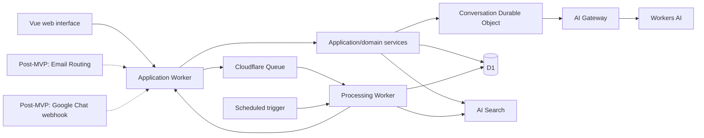

# SalesBot — Engineering Specification

## 1. Authority and fixed decisions

This document is the implementation contract for the product described in [`00-introduction.md`](./00-introduction.md). The MVP supports web chat only. Email through Cloudflare Email Routing and Email Sending, and Google Chat, are explicitly post-MVP extensions that begin after MVP hardening. The product is an internal Cloudflare-sales demonstration. All application infrastructure is Cloudflare infrastructure; Google Chat is only an external protocol integration.

Fixed decisions:

- The repository uses the four tiers `UI → API → application/domain → infrastructure`.
- D1 is authoritative for FAQs, assignments, conversations, escalations, identities, and audit events.
- A Durable Object coordinates one conversation's ordered turns and live browser delivery. It is not a second source of truth.
- All Workers AI calls use AI Gateway. There is no direct Workers AI fallback.
- AI Search indexes approved Cloudflare documentation and FAQ projections. Search results are rechecked against D1 policy before generation.
- Queues provide retryable asynchronous delivery and indexing. All consumers are idempotent.
- Cloudflare Access authenticates browser users; application authorization is checked again on every management operation.
- Wrangler is not used. The `cf` CLI and Terraform own deployment and infrastructure lifecycle.

## 2. Actors and authorization

### 2.1 Identity

MVP browser identity comes only from verified Cloudflare Access middleware and its validated audience. No request body, header, message text, or test-interface field may override a verified identity. The post-MVP Email adapter derives identity from the verified envelope sender plus the approved domain and authentication policy; the post-MVP Google Chat adapter derives it from the verified Google Chat event and allowlisted space.

The application stores a stable identity key, display name, email where available, source channel, and verification method. Display names from the seed CSV are not credentials. Administrators map them to deployment identities during setup.

### 2.2 Roles

| Role | Allowed actions |
| --- | --- |
| Salesperson | Create questions, continue own conversations, request escalation, and receive responses. |
| PM | View assigned/in-scope escalations; answer, reject, reassign, and publish FAQs; manage owned FAQs. |
| Overseer | View queue and response dashboards for managed products. |
| Administrator | Manage all FAQs, the product map, all escalations, role mappings, audit views, and test configuration. |

A PM's product scope is derived from the current product map and is evaluated at action time. Repository ports do not make authorization decisions; application services do. Unauthorized and non-existent management resources use the same safe response where appropriate.

### 2.3 Channel permission matrix

| Channel | Release | Authentication/permission | Permitted operations |
| --- | --- | --- | --- |
| Web chat | MVP | Cloudflare Access, valid audience, approved identity/domain policy | Ask, request escalation, receive response, view own transcript. |
| Console | MVP | Cloudflare Access plus PM/overseer/admin role and product scope | Queue, FAQ, map, dashboard, audit, and test operations according to role. |
| Email | Post-MVP | Approved complete sender domain, DNS anti-spoofing posture, accepted SPF/DKIM/DMARC result according to configured policy | Ask or continue a thread and receive a response. Never management. |
| Google Chat | Post-MVP | Valid Google Chat authentication, approved space/DM, mapped verified identity/domain | Ask in the approved space and receive a threaded reply. Never management. |

Policy is configurable only by an administrator and is fail-closed. Email sender authentication ambiguity is not permission to access restricted knowledge. The answer policy also checks audience classification immediately before delivery.

## 3. Architecture and ownership

### 3.1 Workers

The application Worker owns HTTP routing, Access middleware, web assets, channel adapters, API response shaping, and composition. A processing Worker owns queue consumers, search indexing, expiry marking, notification retries, and scheduled maintenance. They may share application/domain packages but never reach another service's private storage directly.

### 3.2 Durable Object

`ConversationSession` is keyed by a stable conversation ID. It owns turn ordering, cancellation, reconnect state, WebSocket connections, and the agent loop for that conversation. Every turn is persisted to D1 before broadcast or external delivery. DO storage contains only coordination state and disposable cursors; D1 remains authoritative.

The WebSocket upgrade forwards the authenticated request to the DO. The Worker removes every inbound copy of the verified identity header, including case variants, before setting its own header. The DO trusts that header only because it has no public route and can be reached only through the authenticated Worker. A non-upgrade request receives `426 Upgrade Required`.

### 3.3 Cloudflare services

| Service | Responsibility |
| --- | --- |
| Workers | API, web chat, processing, static assets, and scheduled handlers. |
| Durable Objects | Per-conversation agent loop and live web-chat coordination. |
| D1 | Authoritative relational state and audit trail. |
| Queues | MVP indexing and retry isolation; post-MVP channel ingress/delivery retries. |
| AI Search | RAG retrieval over approved documentation and FAQ projections. |
| AI Gateway | Mandatory AI routing, centralized logs, rate/cost controls, and metadata. |
| Workers AI | Decision/routing and answer generation models, reviewed at implementation time. |
| Access | Browser authentication and edge policy. |
| Analytics Engine/Observability | Aggregated operational metrics and structured logs without sensitive payloads. |
| Email Routing (post-MVP) | Inbound email MX routing to the email Worker and operator-controlled domain configuration. |
| Email Sending (post-MVP) | Transactional outbound replies from the Worker to the verified sender, using an onboarded sending domain and a `send_email` binding. |

## 4. Data model

The initial D1 migration contains at least:

- `identities`: verified identity key, authentication source, email/domain where available, role, enabled state.
- `products`: product name, primary PM, default escalation target, active state.
- `product_scopes`: PM/overseer scope and effective timestamps.
- `faqs`: question, answer, product, owner, audience, expiry, status, revision, source escalation, timestamps.
- `faq_index_jobs`: FAQ revision, search document ID, status, attempts, last error.
- `conversations`: stable conversation ID, channel, external thread key, requester, product, status, timestamps.
- `conversation_events`: append-only normalized turns, actor, visibility, content reference/hash, delivery state, correlation ID.
- `escalations`: conversation, question event, product, current assignee, status, opened/answered/closed times, response metrics.
- `escalation_assignments`: append-only assignment history with actor, previous/current assignee, reason, and timestamp.
- `audit_events`: actor, action, resource, reason, correlation ID, and timestamp.

The post-MVP Email/Google Chat migration adds `channel_events` (external event ID, channel, payload hash, conversation, processing state, and unique idempotency key) and `channel_allowlist` (approved domains, Chat spaces, identity mappings, and policy state). The MVP conversation has `channel = web` and does not provision channel ingress state prematurely.

Use foreign keys and uniqueness constraints for FAQ revisions, active product assignment, and one open escalation per triggering question. The post-MVP channel migration adds uniqueness for external event IDs. Raw inbound content is bounded and retention is configurable; routine logs contain lengths, hashes, IDs, and reason codes rather than prompts, transcripts, email bodies, or model output.

## 5. Knowledge and answer workflow

### 5.1 Documentation ingestion

The initial source is `~/repos/cloudflare/cloudflare-docs`. A committed manifest selects Markdown pages and records path, product, title, content hash, source revision, and indexing status. The ingestion worker chunks and indexes only manifest-approved content. It does not crawl arbitrary external URLs. The source manifest and index status are visible to administrators.

### 5.2 FAQ lifecycle

An FAQ is active, expired, or archived. New publication defaults to an expiry date 90 days in the future. A PM may select another date or no expiry. Expiration is checked during retrieval even if the scheduled marker/index cleanup has not run. Only an authorized PM or administrator can publish, edit, archive, or delete a FAQ. Every revision is audited.

Audience values are `internal`, `nda`, `customer`, and `public`. Retrieval filters by audience, requester permissions, active status, product, and expiry. The same filter is applied immediately before delivery. Search index deletion or replacement is retryable and cannot make D1 forget the FAQ lifecycle.

### 5.3 Agent loop

1. Validate size, content type, authenticated web identity, conversation ownership, and idempotency key.
2. Resolve the verified requester, conversation, product classification, and permitted audience.
3. Retrieve documentation and FAQ references from AI Search.
4. Read FAQ state from D1 and discard expired, archived, or unauthorized results.
5. Call the decision model through the shared AI Gateway client.
6. If evidence is insufficient, conflicting, restricted, or escalation was requested, create an escalation transactionally and send the web-chat acknowledgement.
7. Otherwise call the answer model through AI Gateway with bounded context and citations.
8. Persist the answer event before broadcasting it to the authenticated web session.

Post-MVP channel adapters normalize their verified inbound event into this workflow and implement their own durable delivery intent before external sending.

The decision model must not be used as a substitute for authorization or expiry filtering. Generated text is not an FAQ unless a PM explicitly publishes it.

## 6. Escalation rules

MVP statuses are `open`, `assigned`, `answered`, `delivered`, `closed`, and `rejected`. Closing without an answer sends a rejection response through the authenticated web conversation. Post-MVP outbound-channel delivery adds `delivery_failed`; a PM response remains durable and retryable if external delivery fails.

Product routing uses the supplied seed map. An unlisted product defaults to Rita Koslov. The application records the assignment path. A reassignment is rejected if its target appears anywhere in the escalation's prior reassigner set; this prevents direct and longer cycles. The rejected attempt is audited. Administrators may reassign any escalation; PMs may reassign only within policy.

MVP dashboards are D1-derived and include open count, count by product, queue age, first-answer time, total resolution time, rejection count, reassignment count, and FAQ freshness. The post-MVP dashboard adds channel breakdown and delivery-failure metrics; duplicate channel deliveries do not count twice.

## 7. API and channel contracts

Routes are thin and call injected application services:

- `GET /api/me`
- `POST /api/conversations`
- `POST /api/conversations/:id/messages`
- `POST /api/conversations/:id/escalate`
- `GET /api/conversations/:id/events`
- `GET /api/conversations/:id/stream` (WebSocket)
- `GET/POST/PATCH/DELETE /api/faqs`
- `GET/PATCH /api/escalations`
- `POST /api/escalations/:id/answer`, `/reassign`, `/close`
- `GET/PATCH /api/products` and map entries
- `GET /api/dashboard`
- `GET /api/admin/audit`

All JSON errors use RFC 9457 `application/problem+json`. JSON body limits, origin protection for mutations, rate limits, and correlation IDs are mandatory.

### 7.1 Post-MVP channel contracts

After MVP hardening, Email adds `POST /api/channel/email` and Google Chat adds `POST /api/channel/google-chat`; neither route is deployed or exposed during MVP.

Email ingestion acknowledges only after durable queue insertion. It uses bounded plain-text parsing, safe thread identifiers, and no header injection. Outbound replies use Cloudflare Email Sending from an onboarded operator-controlled domain through a Worker `send_email` binding. Replies include both plain-text and HTML alternatives, preserve the conversation/thread headers where supported, and never copy untrusted headers into arbitrary outbound headers. The sending domain must have the required DNS authentication and deliverability configuration. A send attempt is idempotent by conversation event and delivery attempt ID; transient failures are retried through the Queue, while permanent bounces remain visible in the PM console. Deployment must verify Email Sending is enabled for the target domain before enabling the email channel.

Google Chat ingestion validates the supported Google Chat authentication mechanism, allowlists space/thread IDs, deduplicates event retries, and posts replies only to the verified space/thread. Unsupported event types are ignored safely.

## 8. Web interface

The web UI is a Vue 3 Composition API application. It provides authenticated chat, conversation history, citations, escalation controls, PM queue, transcript/evidence view, answer form, close/reassign/publish actions, FAQ editor, product map editor, dashboards, and audit history. It is the MVP's complete test interface. A post-MVP channel simulator may call real adapter/application ports and must display that it is simulated; it is not an MVP requirement.

The UI targets WCAG 2.2 AA: semantic landmarks, keyboard operation, visible focus, live status announcements, mobile layouts, reduced motion, and no color-only status meaning. A PM sees only evidence they are authorized to see. The application never renders raw provider credentials, Access tokens, or untrusted HTML.

## 9. Security, privacy, and observability

Use Access JWT audience validation in the Worker and role/product authorization in the application. Protect admin and PM routes with Access policies and `redirect: false` for API/WebSocket paths. Scrub identity headers before DO forwarding. Use managed secrets and least-privilege bindings.

Every operation carries a correlation ID. Log operation type, model, parameter names, bounded sizes, result reason code, latency, queue IDs where used, and AI Gateway log ID. Post-MVP channel operations add channel metadata. Do not log prompts, answers, transcripts, raw email, attachments, credentials, or verified email addresses. AI Gateway metadata may include a verified identity key and request ID, but not content.

## 10. Infrastructure and lifecycle

For MVP, Terraform owns D1, queues, DO namespace, Access applications/policies, AI Gateway configuration, and documented scalar outputs. The `cf` deployment owns Worker code and generated binding configuration. Local bindings use committed local outputs; production uses ignored Terraform outputs. The root `.env` supplies credentials; no per-demo `.env` or `.dev.vars` is required.

The post-MVP Email extension adds Email Routing/DNS resources owned by the demo and Email Sending domain onboarding/configuration where supported by the selected provider schema. That extension adds the Worker Email Sending `send_email` binding only when the email channel is enabled.

Required scripts are `start`, `check`, `fix`, `test`, `deploy`, and `teardown`. `check` is write-free and runs strict TypeScript, generated types, Oxfmt, type-aware Oxlint, Terraform validation/format checks, and configuration consistency checks. `deploy` provisions before upload and `teardown` deletes application code before infrastructure. D1 migrations use the repository helper.

## 11. Testing and acceptance

MVP pure tests cover classification, audience policy, expiry, routing, cycle prevention, idempotency keys, and state transitions. Workers-runtime tests cover Access outcomes, D1 adapters, Queue handling, DO upgrade/header scrubbing, and authorization failures. DOM tests cover keyboard and PM workflows. Browser tests cover web chat, PM answer, FAQ publication, and dashboard views. Every integration project has a finite timeout; tests are offline.

MVP acceptance requires: an approved web user reaches the complete workflow; unauthorized requests create no answer; retries create one event/escalation; restricted and expired FAQs never leak; PM publication becomes searchable after retryable indexing; rejection appears in the originating web conversation; reassignment cycles are impossible; dashboards agree with D1 events; all AI calls are gateway-routed; and `pnpm start`, `pnpm check`, `pnpm test`, `pnpm deploy`, and `pnpm teardown` work according to repository rules.

Post-MVP channel acceptance adds rejected email/Chat authentication, idempotent external delivery, reply threading, and equivalent conversation/escalation behavior.
