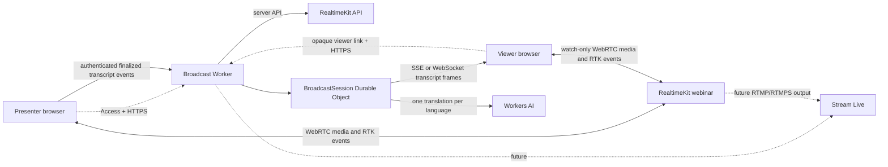

# Town Hall — Enterprise broadcast engineering specification

## 1. Authority and design intent

This document is the engineering specification for the broadcast demo introduced in
[`00-introduction.md`](./00-introduction.md). It turns the introduction's goals into a deliberately
small first release while preserving a credible path to Stream Live delivery.

Normative terms **MUST**, **MUST NOT**, **SHOULD**, and **MAY** have their RFC 2119 meanings. The
first release is a demonstration application, not a production webinar product. Any capability that
requires an account-specific RealtimeKit or Stream feature is isolated behind a port or adapter and
must be proven before it becomes part of the default path.

The specification makes these first-release choices:

1. The first release uses **RealtimeKit-only delivery**. One presenter publishes camera, microphone,
   and optional screen share through a RealtimeKit webinar; viewers join as strictly watch-only
   participants.
2. Stream Live is a separately testable **broadcast extension**, not a hidden prerequisite for the
   initial demo. The application owns the viewer experience and transcript protocol so Stream can be
   introduced without rewriting the domain.
3. There is one presenter per broadcast, with any additional presenter or moderated-stage workflow
   deferred. There may be many watch-only viewers within the account and service limits.
4. The presenter is authenticated with Cloudflare Access. A viewer receives an opaque, revocable,
   broadcast-specific join link; viewers do not receive presenter permissions or service credentials.
5. RealtimeKit is the authority for media participation and managed transcription. Workers AI is an
   application translation step applied only to finalized transcript segments.
6. A Durable Object is used for live transcript coordination because it provides one ordered,
   per-broadcast coordination point. It is not the media server and does not store the authoritative
   media stream.
7. Transcript text is retained only for the active broadcast by default. Recording and durable
   transcript retention are deferred until their privacy, consent, and deletion policies are approved.

## 2. Product scope

### 2.1 First-release goals

The first release demonstrates:

- creation and lifecycle control of one broadcast by an authenticated presenter;
- RealtimeKit camera, microphone, screen-sharing, webinar-role, and transcription capabilities;
- a viewer join link with a strictly view-only media role;
- a presenter-selected stage layout visible consistently to RTK viewers;
- responsive video and transcript presentation on desktop and mobile;
- original-language transcript segments plus three explicitly configured target languages;
- one translation per finalized segment and target language, shared by all viewers of that language;
- transcript follow-live, review, language selection, show/hide, and original-audio controls;
- visible broadcast state and useful connection diagnostics where browser and SDK statistics support
  them; and
- a clean Cloudflare deployment, local development, offline tests, and complete teardown.

### 2.2 Explicit non-goals

The first release does not provide:

- general-purpose meetings, participant admission, breakout rooms, chat, reactions, Q&A, or hand
  raising;
- more than one presenter or a viewer promotion workflow;
- translated or synthesized speech;
- a guarantee of word-level caption synchronization;
- Stream Live playback in the default viewer path;
- recording, replay, searchable transcript history, or durable transcript export;
- automatic detection of the spoken language;
- arbitrary translation languages selected by the user;
- a custom TURN server or a claim that every connection uses TURN; or
- an authentication system separate from Cloudflare Access for presenters.

## 3. Fixed decisions and configurable values

### 3.1 Release configuration

The application has one typed, non-secret broadcast configuration. It is read by the server and the
safe display subset is passed to the browser; the browser must not import server configuration
directly.

```ts
interface BroadcastConfiguration {
  readonly applicationName: string;
  readonly presenterLanguage: string;
  readonly translationLanguages: readonly [string, string, string];
  readonly transcriptRetentionSeconds: number;
  readonly segmentContextCount: number;
  readonly maxViewerLinkLifetimeSeconds: number;
}
```

The initial demonstration defaults are:

- spoken language: `en-US`;
- translation languages: Spanish, French, and German;
- active transcript retention: the lifetime of the broadcast plus a short reconnect window;
- preceding context: a small bounded number of finalized segments; and
- viewer-link lifetime: configurable and short enough that a leaked link is not a permanent grant.

The exact RealtimeKit language identifiers and Workers AI model identifier are configuration values,
not string literals spread across the application. The model must be selected only after checking
current Workers AI language coverage and account availability. Secrets, account IDs, API tokens,
RealtimeKit credentials, Stream keys, and Access audiences are bindings or deployment outputs, never
committed configuration.

### 3.2 Broadcast state machine

The application domain owns this lifecycle:

```text
created → waiting → live → ended
                     ↘ disconnected → live
created → ended
```

- `created` means a presenter session and viewer link can be prepared but media has not started.
- `waiting` means the broadcast is available and viewers may join, but the presenter has not started
  the live stage.
- `live` means the presenter is connected and the stage is intended for viewing.
- `disconnected` is a recoverable interruption. Viewers retain transcript history and see a reconnect
  message while the application waits for the presenter or RTK session to recover.
- `ended` is terminal for the first release. Existing viewers see the final transcript and a clear
  ended state; a new broadcast receives a new identifier and link.

State transitions are validated in the application layer. A browser cannot mark a broadcast live by
sending an arbitrary state value.

## 4. Architecture



### 4.1 Four-tier ownership

Dependencies point in one direction:

```text
UI → HTTP/API → application/domain → infrastructure
```

| Tier | Owns | Must not own |
| --- | --- | --- |
| UI | presenter/viewer controls, media rendering, transcript interaction, accessible states | credentials, authorization, translation decisions, direct platform calls |
| API | routes, request authentication, viewer-link validation, parsing, response shaping | D1/DO construction, business state transitions, translation policy |
| Application/domain | broadcast lifecycle, role policy, segment ordering, deduplication, language policy, use cases | Hono request objects, concrete bindings, browser media objects |
| Infrastructure | RealtimeKit client, Workers AI adapter, Durable Object gateway, durable metadata adapter | UI policy, caller-provided identity, duplicated validation |

The composition root constructs infrastructure adapters and injects them into application services. API
handlers remain thin descriptions of the HTTP surface.

### 4.2 Cloudflare product responsibilities

- **Workers** serve the SPA, authenticate requests, mint or validate short-lived provider tokens,
  expose the API, and coordinate the application services.
- **RealtimeKit** owns the webinar room, media routing, presenter/viewer roles, WebRTC negotiation,
  STUN/TURN behavior, and managed real-time transcription.
- **Durable Objects** own ordered, ephemeral transcript coordination for one broadcast at a time.
  A broadcast ID deterministically selects one `BroadcastSession` object.
- **Workers AI** translates finalized original-language segments into configured target languages.
- **D1** stores broadcast metadata, hashed viewer-link grants, lifecycle timestamps, and small audit
  records. It is not used for every live transcript frame.
- **Stream Live** is reserved for the later high-scale audience path. Its ingest credentials and
  playback identifiers must remain server-side.

R2, KV, Queues, and a separate TURN deployment are not provisioned in the first release unless a
reviewed implementation constraint requires one of them. In particular, the RTK media path must not
be reimplemented with a Worker or Durable Object.

## 5. Identity, access, and authorization

### 5.1 Presenter access

Presenter pages and all presenter API routes are protected by Cloudflare Access. The Worker validates
the Access JWT, including the expected application audience, and derives the presenter identity only
from the verified middleware context. It never accepts an email, role, or presenter ID from a request
body, query string, or client header.

The presenter authorization policy is intentionally simple for the demo: a configured administrator
or explicitly permitted presenter identity may create and control broadcasts. This policy is a server
configuration value or Access policy, not a UI convention. Every presenter mutation checks it again in
the application service.

Use the shared Worker library for Access middleware, verified identity, `/api/me`, JSON limits, and
RFC 9457 problem responses. Local development emulates the same Access path with development tokens;
production cannot enable that bypass.

### 5.2 Viewer access

A presenter requests a viewer link after creating a broadcast. The server generates a cryptographically
random opaque secret, stores only a SHA-256 digest with the broadcast ID and expiry, and returns the
raw link once. The raw secret is never logged, persisted, or returned by a later status endpoint.

A viewer link:

- can read only the associated broadcast's public viewing projection;
- can obtain only a short-lived, viewer-role RTK join token from the server;
- cannot call presenter routes or create another viewer token;
- cannot choose a different broadcast ID by changing a URL parameter; and
- is revocable by the presenter before the broadcast ends.

Viewer-link validation returns a deliberately non-enumerating not-found response for absent, expired,
revoked, or malformed grants. A link is not treated as an Access identity and is not used to authorize
presenter operations.

### 5.3 Media-role enforcement

The server creates or configures RTK participation with the appropriate role. The viewer role MUST be
strictly watch-only in provider configuration. Hiding camera and microphone buttons is not sufficient.
The presenter role is the only role allowed to publish camera, microphone, or screen-share tracks and
to control the stage lifecycle.

The browser uses provider-issued tokens only for the assigned role. Tokens and provider API credentials
are never embedded in static assets, URLs visible to other users, logs, or problem responses.

## 6. Domain model and contracts

### 6.1 Broadcast metadata

The durable broadcast record contains:

```text
broadcasts
- id                    opaque UUID
- presenter_email       verified presenter identity
- title                 bounded display title
- spoken_language       configured RTK language identifier
- state                 created | waiting | live | disconnected | ended
- layout                camera | presentation-picture-in-picture | side-by-side
- rtk_room_id           provider room identifier
- created_at
- started_at nullable
- ended_at nullable
- updated_at
```

The record does not contain media bytes, provider secrets, raw viewer-link secrets, or an unbounded
transcript. Provider identifiers are treated as credentials where the provider requires it and are
never included in public DTOs.

Viewer-link grants contain a digest, broadcast ID, created/expiry/revocation timestamps, and a safe
creation audit reference. Transcript segments are live state in the Durable Object and are deleted by
alarm or explicit end cleanup after the reconnect window.

### 6.2 Shared transcript frame types

The Worker and browser share a runtime-neutral discriminated union. The wire protocol has no author
field because only the authenticated presenter event ingress can create an original segment.

```ts
type TranscriptFrame =
  | {
      readonly type: 'segment';
      readonly segmentId: string;
      readonly sequence: number;
      readonly spokenLanguage: string;
      readonly originalText: string;
      readonly translations: Readonly<Record<string, string>>;
      readonly isFinal: true;
      readonly mediaTimestampMs: number | null;
    }
  | {
      readonly type: 'interim';
      readonly segmentId: string;
      readonly originalText: string;
      readonly spokenLanguage: string;
    }
  | {
      readonly type: 'translation-pending';
      readonly segmentId: string;
      readonly language: string;
    }
  | {
      readonly type: 'transcript-status';
      readonly status: 'available' | 'degraded' | 'ended';
      readonly detail: string;
    };
```

Interim frames are replaceable by `segmentId` and are never sent to Workers AI. Final frames are
identified by a stable segment ID and monotonically increasing sequence. A reconnecting viewer first
receives a bounded ordered snapshot, then live frames. The client rejects an older or duplicate final
sequence without deleting newer content.

### 6.3 Application ports

The domain depends on ports rather than products:

```ts
interface BroadcastRepository {
  get(id: string): Promise<Broadcast | null>;
  create(input: CreateBroadcast): Promise<Broadcast>;
  transition(id: string, transition: BroadcastTransition): Promise<Broadcast>;
  revokeViewerLinks(id: string): Promise<void>;
}

interface ViewerGrantRepository {
  create(input: CreateViewerGrant): Promise<RawViewerLinkGrant>;
  resolve(digest: string, now: string): Promise<ViewerGrant | null>;
  revoke(id: string): Promise<void>;
}

interface RealtimeKitPort {
  createRoom(input: CreateRoomInput): Promise<ProviderRoom>;
  issuePresenterToken(input: PresenterTokenInput): Promise<string>;
  issueViewerToken(input: ViewerTokenInput): Promise<string>;
  configureTranscription(input: TranscriptionInput): Promise<void>;
  endRoom(roomId: string): Promise<void>;
}

interface TranslationPort {
  translate(input: TranslationInput): Promise<string>;
}
```

The concrete adapters contain provider-specific request and response shapes. No route or UI module
imports a RealtimeKit SDK client, Workers AI binding, D1 database, or Durable Object stub directly.

## 7. API surface

All JSON mutations use the shared JSON body limit and return `application/problem+json` on failure.
Successful responses are explicit DTOs and do not expose database rows or provider secrets.

| Method and path | Access | Behaviour |
| --- | --- | --- |
| `GET /api/me` | presenter Access | verified identity and presenter capability |
| `POST /api/broadcasts` | presenter Access | create a broadcast and RTK room in `created` state |
| `GET /api/broadcasts/:id` | presenter Access | presenter control projection |
| `POST /api/broadcasts/:id/viewer-link` | presenter Access | create/rotate a viewer grant; show raw link once |
| `DELETE /api/broadcasts/:id/viewer-link` | presenter Access | revoke viewer grants |
| `POST /api/broadcasts/:id/start` | presenter Access | transition to `waiting` or `live` after provider setup |
| `POST /api/broadcasts/:id/end` | presenter Access | end provider session and transcript coordination |
| `PATCH /api/broadcasts/:id/layout` | presenter Access | set one of the supported layouts |
| `GET /api/view/:grant` | viewer grant | public viewing projection and short-lived viewer token |
| `GET /api/view/:grant/transcript` | viewer grant | bounded transcript snapshot for reconnect/late join |
| `POST /api/broadcasts/:id/transcript-events` | presenter Access | accept authenticated RTK final/interim event forwarding |
| `GET /api/broadcasts/:id/insights` | presenter or viewer session | safe, current connection-insight projection where available |
| `GET /api/broadcasts/:id/transcript-stream` | viewer grant | transcript stream; non-upgrade requests receive the shared upgrade-required response if WebSocket is selected |

The transcript event route accepts only the provider event schema required by the selected SDK
integration. It verifies that the authenticated presenter controls the referenced broadcast, validates
sequence and segment IDs, bounds text and context, and rejects a client-supplied author. It must be
idempotent: retries of the same finalized event do not create a second segment.

The first implementation may use Server-Sent Events for the viewer transcript channel because it is
one-way and easy to reconnect. If WebSockets are selected after an explicit browser/runtime test, the
upgrade must be forwarded to the Durable Object, accepted with the hibernation API, and the verified
viewer identity must be attached to the socket. A normal HTTP request to that route returns `426 Upgrade
Required`, not `400`.

## 8. Transcript processing

### 8.1 Event ingress

RealtimeKit transcription events are observed in the presenter/browser integration according to the
supported SDK contract. The browser forwards only the bounded event data needed by the Worker over an
authenticated presenter request. The Worker does not assume that a browser event is a backend
subscription and does not claim delivery guarantees the SDK does not provide.

The ingress service performs these steps:

1. authenticate the presenter and resolve the broadcast;
2. validate the event's broadcast/session association and spoken language;
3. normalize text, segment ID, sequence, finality, and optional media timestamp;
4. discard stale or duplicate interim/final events according to the Durable Object's idempotency
   rules; and
5. send the accepted event to the per-broadcast coordinator.

A later implementation may replace browser forwarding with a provider webhook or server event source,
but it must preserve the same application port and frame contract.

### 8.2 Ordering and translation

The `BroadcastSession` object maintains:

- the next expected final sequence and a bounded gap buffer;
- accepted finalized segments by stable segment ID;
- a bounded recent transcript snapshot;
- active viewer language subscriptions;
- translation status by `(segmentId, language)`; and
- connected viewer streams.

Finalized segments are persisted in object storage before broadcast. Translation tasks are deduplicated
by `(segmentId, language)` and run once for each active configured target language. A viewer selecting
a language does not start a viewer-specific translation if the result already exists. Translation
failure emits a visible fallback frame containing the original text and a degraded status; it does not
remove the original segment.

Translation uses a small bounded preceding context where the model supports it. Context is not allowed
to grow without limit, and logs must not contain transcript text. AI calls have a bounded timeout and
retry policy. Retries must use the same deduplication key and cannot reorder final output.

### 8.3 Late join, reconnect, and language change

A late viewer receives the current broadcast state, a bounded ordered transcript snapshot, and then live
frames. A reconnecting viewer may request the snapshot again; the client merges by segment ID and
sequence rather than appending blindly.

Changing language preserves the original transcript and requests already-computed translations from the
coordinator. Missing translations are marked pending and computed once. If the selected language is the
spoken language, the original text is rendered directly and no AI call is made.

Transcript retention ends when the broadcast ends plus the configured reconnect window. The Durable
Object alarm removes transient transcript state. Any move to durable retention must specify consent,
access control, deletion, and data-residency behaviour before implementation.

## 9. Client experience

### 9.1 Presenter surface

The presenter UI contains:

- preflight device selection and permission status;
- camera, microphone, and screen-share controls;
- start, disconnect/reconnect, and end controls;
- layout selection for camera-only, presentation picture-in-picture, and side-by-side;
- current broadcast state and viewer-link creation/revocation;
- transcript language/spoken-language status; and
- an expandable connection-insights panel.

Every control has a keyboard path, accessible name, disabled/loading state, and error feedback. Browser
permission denial is explained without exposing provider internals. Screen-share audio is described as
browser/platform dependent.

### 9.2 Viewer surface

The viewer UI contains:

- the RTK video stage, following the presenter-selected layout;
- independent original-audio mute/unmute control;
- broadcast state and reconnection messages;
- transcript language selector limited to configured languages;
- transcript show/hide control;
- an auto-following transcript with the current segment emphasized;
- retained earlier segments; and
- a **Follow live** action that appears when manual scrolling suspends following.

The transcript is beside the stage on desktop and below it on narrow screens. It must remain usable at
small viewport sizes without forcing horizontal scrolling. Automatic scrolling pauses when the viewer
scrolls away from the live region and resumes only through Follow live or an explicit equivalent action.

Interim text is visually distinct and replaceable; finalized text is stable. Translation failures are
visible as a concise status and original-language fallback, never as an empty paragraph or silent loss.

### 9.3 Connection insights

The panel reports observed values only:

- RTK connection state;
- round-trip time when available;
- packet loss when available;
- send/receive bitrate when available; and
- selected candidate or relay indication when the browser exposes it reliably.

Unavailable values are shown as unavailable, not zero. The UI labels the path as RTK/WebRTC. If Stream
is later enabled, its HLS/DASH viewer path gets a separate playback-health panel and must not be described
as using STUN or TURN.

## 10. Stream Live extension boundary

Stream is a later delivery mode, gated by a proof of concept. The proof must validate:

1. RTK's supported output configuration and whether its output is compatible with Stream's ingest;
2. start/stop lifecycle and failure recovery;
3. composed layout fidelity for all supported presenter layouts;
4. playback URL/token handling and viewer access policy;
5. transcript timestamp mapping against actual player latency and buffering; and
6. account limits, billing, retention, and teardown behaviour.

When implemented, the Stream adapter owns ingest configuration and playback metadata. The application
still owns broadcast state, viewer authorization, transcript frames, and language policy. Stream viewers
receive HLS/DASH media and do not join the RTK webinar. Transcript alignment uses a media timestamp and
measured playback timeline; a fixed delay may be an experimental fallback but must be labelled as such.

The Stream extension must be feature-gated and must not make a missing Stream binding break the RTK-only
release. Stream keys remain server-side and are never sent to the browser.

## 11. Infrastructure and lifecycle

### 11.1 Resource ownership

Terraform owns Worker registrations, the D1 database, Durable Object binding/migration metadata,
Cloudflare Access applications/policies, and the custom hostname. The application deployment CLI owns
built Worker code and static assets. RealtimeKit and Stream account resources are managed through their
supported APIs/adapters, not by storing credentials in Terraform state unless the provider explicitly
requires a secret-safe mechanism.

There is one clear owner for each resource. Application deletion happens before infrastructure
teardown so bindings and Access resources do not retain a live deployment.

### 11.2 Required repository shape

```text
cf-terraform-demos/town-hall/
├── cloudflare.config.ts
├── package.json
├── vite.config.ts
├── tsconfig.json
├── oxlint.config.ts
├── vitest.config.ts
├── infra/
│   ├── providers.tf
│   ├── access.tf
│   ├── application.tf
│   ├── realtime.tf
│   ├── data.tf
│   ├── outputs.tf
│   └── local-outputs.json
├── migrations/
│   └── 0001_broadcasts.sql
├── src/
│   ├── shared/{broadcast,transcript,api,validation}.ts
│   ├── worker/{api,application,domain,infrastructure,index.ts}
│   ├── durable-objects/broadcast-session.ts
│   └── client/{components,composables,services,views,App.vue,main.ts}
└── tests/
    ├── unit/{domain,application,transcript,client}/
    ├── contract/
    ├── integration/
    └── e2e/
```

The exact framework follows the demo-family conventions, but TypeScript strict mode, Vue 3 Composition
API where Vue is selected, Hono, Vite, `cf`, pnpm, Oxfmt, Oxlint, and Vitest remain required. Wrangler
is forbidden by repository policy. Shared Worker concerns use `@demos/worker-common` and the Cloudflare
toolkit rather than local copies.

### 11.3 Scripts

The package defines individually runnable namespaced scripts:

- `start`: apply local D1 migrations and start local development with persisted local state;
- `check`: regenerate binding types, run strict TypeScript, Oxfmt check, type-aware Oxlint,
  Terraform validation/format checks, and a write-free production build;
- `fix`: apply formatting, safe lint fixes, and Terraform formatting;
- `test`: run unit, client, contract, Workers-runtime, and offline browser tests;
- `deploy`: apply Terraform, write outputs, apply remote migrations, build, and deploy the Worker; and
- `teardown`: delete the deployed Worker/application resources first, revoke external broadcast
  resources, then destroy Terraform infrastructure.

`check` must never rewrite files. Deploy and teardown must be non-interactive and idempotent. The
repository-root migration helper is used for D1; a demo-local direct D1 migration command is not used.

## 12. Security, privacy, and observability

- Access JWTs, viewer secrets, provider tokens, Stream keys, and AI credentials never appear in logs or
  client bundles.
- Raw viewer link secrets are returned once and stored only as digests.
- Transcript text is treated as sensitive user content. Logs contain IDs, counts, language codes,
  durations, outcome, and error category, not transcript text or model prompts.
- Every protected route validates the exact Access audience and actor. Viewer routes validate the
  broadcast grant on every request.
- Presenter transcript ingress rejects smuggled identity headers and derives identity from verified
  Access context.
- State-changing browser requests use same-origin and JSON checks where applicable.
- Provider and AI failures return safe RFC 9457 problem details; deployed responses never include stack
  traces or raw provider error bodies.
- Observability distinguishes presenter RTK/WebRTC, viewer RTK/WebRTC, transcript ingress, translation,
  and later Stream playback. Correlation IDs connect a broadcast operation to provider calls without
  logging content.
- The UI explicitly states that transcription is active and that transcript data is transient under
  the first-release policy. Recording is not silently enabled.

## 13. Testing strategy and acceptance

### 13.1 Unit and contract tests

Pure tests cover:

- broadcast state transitions and authorization;
- viewer-link digest, expiry, revocation, and non-enumerating failures;
- supported layout and language validation;
- transcript normalization, stable IDs, sequence ordering, duplicate suppression, gap handling, and
  bounded context;
- translation deduplication, fallback, timeout, and retry behaviour; and
- client transcript merge, follow-live suspension/resumption, language changes, and responsive state.

The fake RealtimeKit, translation, repository, and Durable Object gateway implementations pass the same
contract tests as the concrete adapters.

### 13.2 Workers-runtime integration

Runtime tests run offline with a finite timeout and cover:

- Access success, wrong audience, expired token, and smuggled identity headers;
- presenter-only creation, layout, start, and end operations;
- viewer-link read-only behaviour and denial of presenter mutations;
- provider-token role assignment;
- authenticated transcript ingress and retry idempotency;
- Durable Object snapshot/reconnect ordering and cleanup alarm;
- translation failure with original-language fallback; and
- D1 migration and repository behaviour.

If a WebSocket transport is selected, tests cover forwarded upgrades, `426 Upgrade Required`,
case-insensitive identity-header scrubbing, socket attachment identity, and post-hibernation message
handling.

### 13.3 Browser acceptance

Offline E2E tests run against local development in desktop and mobile viewports. They cover presenter
preflight and controls, viewer join, independent audio mute, transcript language selection, interim to
final replacement, manual transcript review, Follow live, reconnect state, and ended state. Keyboard-only
navigation and accessible names are tested for all primary controls.

### 13.4 Non-negotiable acceptance conditions

1. `pnpm check` and `pnpm test` pass from a clean checkout without live Cloudflare, RTK, Stream, or AI
   dependencies.
2. `pnpm start` works with only the repository-root environment configured and exercises the local
   Access emulation and local resource simulation.
3. `pnpm deploy` followed by `pnpm teardown` is idempotent and leaves no demo-owned application,
   binding, Access, D1, or Durable Object infrastructure behind.
4. A presenter cannot be authorized by a client-supplied identity, and a viewer cannot obtain a
   presenter-role token or call presenter mutations.
5. Repeated transcript delivery cannot duplicate or reorder finalized segments.
6. Twenty viewers selecting one target language cause at most one translation per finalized segment
   for that language in the coordinator's active window.
7. Translation or provider failure visibly preserves the original-language transcript.
8. The transcript remains usable on desktop and mobile, with accessible follow-live and review
   behaviour.
9. Connection insights report observed RTK/WebRTC facts and clearly distinguish unavailable values and
   the future Stream path.
10. Stream is either absent from the release-one deployment or passes the separately documented proof
    gates in §10; it is never silently presented as validated.

## 14. Open questions and review gates

These do not block the RTK-only first release but must be resolved before the relevant extension:

- the final public application name and hostname;
- the exact RealtimeKit SDK event and token APIs available to the target account;
- whether the browser-forwarded transcript event path is sufficient or a provider server event path is
  available;
- the exact three translation language identifiers and Workers AI model coverage;
- whether SSE or hibernating WebSockets provides the best transcript transport for the selected runtime;
- the maximum intended viewer count and provider limits;
- the RTK-to-Stream output compatibility and layout composition behaviour;
- a robust mapping from transcript/media timestamps to Stream playback time;
- whether viewer links require additional enterprise identity gating;
- transcript consent, retention, deletion, residency, and recording policy; and
- the exact reliable browser statistics available for TURN relay demonstration.

No implementation may resolve these by silently weakening role enforcement, exposing a credential, or
claiming a provider capability that has not been tested against the deployed account.
